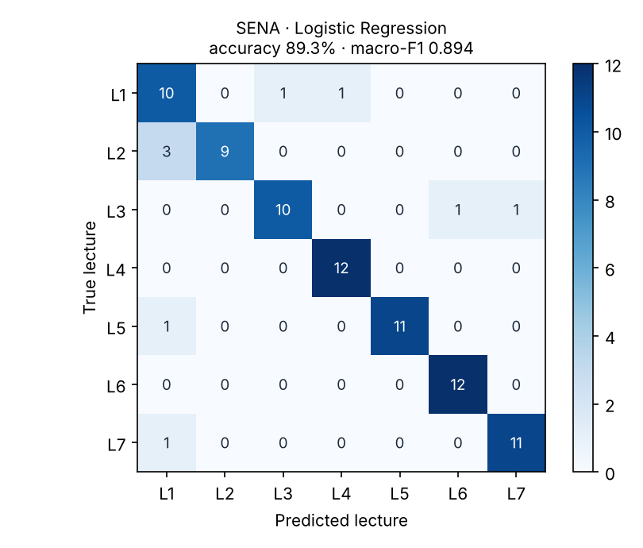
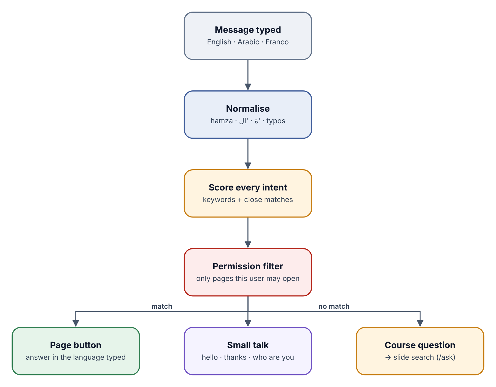

# Masar · مسار — Course Study Assistant


**Author and owner:** Ahmed Esam Yahia Hallawa · © 2026, all rights reserved · **Live site:** <https://ahmedhallawa.pythonanywhere.com>

**Masar** (*“path”* — *your path to the exam*; the project was called StudyMate until 16 November 2026) answers a student's question **only from the lecture slides of his course**, always shows the *source* (lecture and slide number), and says **"Not found in the course"** instead of inventing an answer. Around that core it is a complete study site for three kinds of users — **students**, **doctors** and **administrators** — in **English and Arabic**, light and dark mode, on computers and phones.

This repository is the **project description** — what was built, how it works, which AI models were used and how well they perform. It contains no source code and no site data.

| File | What it is |
|---|---|
| [Masar_Report.pdf](Masar_Report.pdf) | the full technical report (131 pages): problems and solutions, history from the first Flask prototype to Masar, every function and why it was added, the three workflows and their access rights, the CNN, OCR and text models explained with the real code, results, screenshots, references |
| [Masar_Presentation.pptx](Masar_Presentation.pptx) · [.pdf](Masar_Presentation.pdf) | presentation, 36 slides with speaker notes |
| [Masar_Demo.mp4](Masar_Demo.mp4) | demo video (10 min): Part 1 on a computer — the student, doctor and administrator workflows with animated cards explaining every algorithm; Part 2 on a phone — the student workflow |

## What the project is made of

Masar is a complete web product, not a single model. It has seven parts that work together:

| Part | What it is | Size |
|---|---|---|
| **1. The web application** | A Flask (Python) server with Jinja2 pages, one shared CSS design kit (English/Arabic, right-to-left, light/dark) and small JavaScript. Every page checks the user's role and permissions. | about 14,000 lines of Python, 109 routes, 56 page templates |
| **2. The course data** | For each of the 20 Mechatronics courses: the lecture slides (PDF and structured text), one passage per slide, 7 topics (one per lecture) with prerequisites, a bank of 420 questions with correct answers and hints, and 40 off-topic questions that must be refused. | 140 lectures · 2,100 slides · 8,400 questions |
| **3. The text models** | Search over the slides (TF-IDF, BM25, LSA, hybrid, optional neural), the "Not found" gate, the topic classifier (Naive Bayes, Logistic Regression, ensemble). One set of models per course, trained automatically from the course files. | 20 course models |
| **4. The image model** | MobileNetV2 (CNN) trained on slide images + Tesseract OCR with a text model, fused, to recognise the course and lecture of a phone photo. | 140 lecture classes |
| **5. The student model** | Level per topic (mastery), "study next", spaced review, the day-by-day study plan, badges. | per student |
| **6. The assistant and tools** | Rafiq (chat assistant), exams with timer and automatic grading, the Study Studio (summary, flash cards, quiz, mind map, infographic, key terms), My files (a student's own notes), announcements, chat between students and doctors, calendar, notifications, support inbox. | 56 server modules |
| **7. Operation and safety** | Three roles with nine sub-administrator permissions, activity log, site visitors page, daily backups, data vault, danger zone, licence-key gate, automatic tests. | 113 automatic tests |

**Three kinds of users.** *Students* ask, practise, take exams, follow their level and plan. *Doctors* (lecturers) run their own courses: upload lectures and banks, schedule exams, see their students and weekly reports. The *main administrator* (with optional sub-administrators) manages everything: courses, doctors, accounts, models, backups, monitoring.

**How a question travels through the system.** The student types or photographs a question → (a photo is first read by OCR and recognised by the CNN + text model) → the question is translated to the course vocabulary if it is Arabic → the topic classifier proposes the lecture → the search scores every slide and re-ranks them with the topic → the gate checks similarity and word coverage → the page shows the best slides with lecture and slide number, or "Not found in the course" → the student's level for that topic is updated when he practises.

**Where the data lives.** Course files and trained models are stored per course; accounts, chats, uploads and settings in JSON files; the activity log in SQLite; backups are made daily by the site itself. Student, doctor and administrator data are never published.

**Hosting.** Python 3 on PythonAnywhere (free plan: limited disk and CPU, so heavy training such as the CNN is done on Google Colab and only the trained text half runs on the site).

## Contents
1. [The problem and the idea](#1-the-problem-and-the-idea)
2. [The data: twenty Mechatronics courses](#2-the-data-twenty-mechatronics-courses)
3. [AI models and results](#3-ai-models-and-results)
4. [Features — student, doctor, administrator](#4-features)
5. [Workflows](#5-workflows)
6. [Architecture and technology](#6-architecture-and-technology)
7. [How the project evolved](#7-how-the-project-evolved)
8. [Problems met and how they were solved](#8-problems-met-and-how-they-were-solved)
9. [Security and privacy](#9-security-and-privacy)
10. [Limitations and future work](#10-limitations-and-future-work)
11. [Guide to the technical report](#11-guide-to-the-technical-report-masar_reportpdf-131-pages)
12. [Ownership](#12-ownership)

---

## 1. The problem and the idea

* Before an exam, students do not know which topics they really understand.
* General chatbots answer from the open internet: fluent, confident, and often outside the course or simply wrong.
* Hundreds of PDF slides are hard to search; a keyword search fails when the student uses other words.
* The lecturer cannot see what students ask or where they are weak.

The goal is a tutor that **answers only from the slides with the source**, **detects the topic** of each question,
gives **practice with hints**, **tracks the level per topic**, **suggests what to study next**, and **says "Not found"** instead of inventing.
Masar does all of that with small, explainable models that run on free hosting, and adds everything a real course needs around it.

## 2. The data: twenty Mechatronics courses

The site runs on **20 courses** of the Mechatronics program (material version v7, 16 Nov 2026). Each course has 7 lectures (15 slides each, as PDF **and** as a
structured file with every slide's title, bullets, note and equations) and a question bank of **420 questions** (37 multiple-choice + 23 true/false per lecture)
with the correct answer and a short explanation.

| Code | Course | العربية | Lectures | Slides | Bank questions |
|---|---|---|---|---|---|
| AUTO | Automotive Engineering | هندسة السيارات | 7 | 105 | 420 |
| AUTN | Autonomous Systems Engineering | هندسة الأنظمة الذاتية | 7 | 105 | 420 |
| BIOM | Biomechatronics | الميكاترونكس الحيوية | 7 | 105 | 420 |
| CTRL | Control Systems Engineering | هندسة نظم التحكم | 7 | 105 | 420 |
| ROBO | Robotics Engineering | هندسة الروبوتات | 7 | 105 | 420 |
| SENA | Sensors and Actuators | الحساسات والمشغلات | 7 | 105 | 420 |
| EPLC | Embedded Systems and PLC Automation | النظم المدمجة وأتمتة المتحكمات المنطقية المبرمجة | 7 | 105 | 420 |
| FLUD | Fluid Mechanics | ميكانيكا الموائع | 7 | 105 | 420 |
| PELC | Power Electronics | إلكترونيات القدرة | 7 | 105 | 420 |
| STAT | Statics | الاستاتيكا | 7 | 105 | 420 |
| DYNA | Engineering Dynamics | الديناميكا الهندسية | 7 | 105 | 420 |
| STRM | Strength of Materials | مقاومة المواد | 7 | 105 | 420 |
| THRM | Engineering Thermodynamics | الديناميكا الحرارية | 7 | 105 | 420 |
| HEAT | Heat Transfer | انتقال الحرارة | 7 | 105 | 420 |
| MDSN | Machine Design | تصميم الآلات | 7 | 105 | 420 |
| CIRC | Electric Circuits | الدوائر الكهربية | 7 | 105 | 420 |
| EMCH | Electrical Machines | الآلات الكهربية | 7 | 105 | 420 |
| DLOG | Digital Logic Design | التصميم المنطقي الرقمي | 7 | 105 | 420 |
| SIGS | Signals and Systems | الإشارات والنظم | 7 | 105 | 420 |
| MCNC | Manufacturing Processes and CNC | عمليات التصنيع والتحكم الرقمي CNC | 7 | 105 | 420 |
| | **Total** | | **140** | **2,100** | **8,400** |

The official course-code list was updated with the 20 codes, names and results.

Everything the models were trained and tested on is in the repository:

| File | Content |
|---|---|
| `data/<CODE>/lectures/*.pdf` | the lecture slides |
| `data/<CODE>/lecture_json/*.json` | the same slides as structured text (title, bullets, note, equations) — extra training text |
| `data/<CODE>/question_variants.csv` | training questions attached to their best slide (search index expansion) |
| `data/<CODE>/question_bank_source/*.pdf` | the original question banks (questions only, and questions with answers) |
| `data/<CODE>/questions_labeled.csv` | the 420 questions labelled with their lecture, each marked **train** or **test** |
| `data/<CODE>/passages.csv` | one row per slide: the text the search answers from |
| `data/<CODE>/topics.csv` | one topic per lecture, English and Arabic names, prerequisites |
| `data/<CODE>/exams/bank.json` | the exam bank (420 questions with correct answers) |
| `data/<CODE>/question_bank.csv` | practice questions with two hints each |
| `data/<CODE>/offtopic_test.csv` | 40 questions outside the course (English + Arabic) that must be refused |
| `models/<CODE>/` | trained topic classifier, search index, tuned "Not found" threshold |
| `static/reports/<CODE>/` | metrics (JSON), confusion matrices, F1 per lecture |

The whole build (reading the lecture and question-bank files, training, evaluating, writing the metrics and confusion matrices) is one automatic script, so adding a course is a repeatable step.

> **The original course.** The project was first built and evaluated on the *Artificial Intelligence* course (7 lectures, 200 slide passages,
> 466 hand-written labelled questions). That course is kept in `data/AI` for the automatic tests and the November report, and hidden from the site.

## 3. AI models and results

| Component | Method |
|---|---|
| Slide search | **TF-IDF + cosine similarity** (default), **BM25**, **LSA** (TruncatedSVD), **Hybrid**, optional neural embeddings (fastembed) |
| "Not found" gate | best similarity ≥ θ **and** ≥ c of the question's words exist in the course (typos tolerated); θ and c tuned by grid search on training data only |
| Topic classifier | TF-IDF (word 1–2-grams + character 3–5-grams) → **Multinomial Naive Bayes** / **Logistic Regression** / **soft-vote ensemble**, chosen by 5-fold CV on training questions |
| Topic re-ranking | slide score × (1 + w · P(topic)) |
| Mastery model | m ← m + 0.35 (outcome − m); outcome 1 / 0.7 / 0.4 / 0 for no hint / one / two hints / wrong; red < 0.40 ≤ amber < 0.70 ≤ green |
| Study next + spaced review | weakest topic whose prerequisites are green; reviews after 1, 3, 7 days |
| Arabic questions | course-term glossary → English slide terms |
| Images | OCR (Tesseract) for picture-only slides and photo questions; **image model = CNN (MobileNetV2 transfer learning) + OCR text model**, fused — 90.0 % lecture / 93.6 % course on unseen slide photos |
| Exam grading | answer key for MCQ / true-false; essays by text similarity + keywords (full / half / zero) |
| Study Studio | extractive summary, key terms, definitions, flash cards, cloze quiz, mind map — built from the slides, nothing invented |
| Chat assistant **Rafiq** | intent router (English / Arabic / Franco), permission filter, falls back to slide search |
| My files | per-student index over his own notes + topic tagging with the course classifier |

### 3.0 How each model works (in plain words)

**Search — finding the right slide.** Every slide (title, bullets, notes, equations) is a small document. Four ways of scoring a question against the slides were implemented and compared on the same held-out questions:
* **TF-IDF + cosine similarity (the default).** A word counts more when it is rare in the course and frequent on the slide: weight = tf × (ln((1+N)/(1+df)) + 1). Slide and question become vectors and the slide with the largest angle-based similarity wins. It is fast, needs no training and can be explained to a student ("these words matched").
* **BM25.** A probabilistic refinement of TF-IDF that stops very long slides from winning just because they repeat words.
* **LSA (latent semantic analysis).** A truncated SVD of the TF-IDF matrix gives each slide a position in a small "topic space", so a question that uses *other words for the same idea* still finds the slide.
* **Hybrid.** Half TF-IDF (exact words) and half LSA (related words).
* **Neural embeddings (optional).** A small open sentence-embedding model (BAAI/bge-small-en-v1.5, ~130 MB, run on CPU) is available as a fifth method. It is optional because the free hosting plan cannot always download or run it.

**Index expansion.** The training questions are attached to the best slide of their own lecture and added to the index, so a student who phrases a question the way earlier students did finds the slide faster. This raised Top-1 on the original course from 75.5 % to 80.9 %.

**The "Not found" gate.** A search always returns some slide, so a wrong answer would look as confident as a right one. The system therefore answers only when **both** conditions hold: the best similarity is at least a threshold θ **and** at least a fraction c of the question's content words exist somewhere in the course (typos are tolerated). θ and c are chosen by grid search on training data only. Result on 400 off-topic questions (20 per course): **386 refused**.

**Topic classifier.** The topic of a question is the lecture it was written for. Text is turned into TF-IDF features (words of length 1–2 and character 3–5-grams, so spelling mistakes still match) and fed to three candidates: **Multinomial Naive Bayes**, **Logistic Regression**, and a **soft-vote ensemble** (average of their probabilities). The kept model is chosen by **5-fold cross-validation on the training questions only**, never on the test questions. Mean accuracy on held-out questions: **87.7 %** (chance with 7 lectures: 14.3 %). The topic probability also re-ranks the search: slide score × (1 + w · P(topic)).

**Arabic questions.** A glossary of course terms maps Arabic words to the English words used on the slides before searching.

**Image model — which course and lecture is a photo from?** Two models are fused:
* **CNN (MobileNetV2, transfer learning).** A network pre-trained on ImageNet is frozen and a small new classification head (global average pooling → dropout → softmax) is trained on slide images with random flip, rotation, zoom and brightness changes. Because all slides share one template, the picture alone carries little information, so the CNN alone reaches only 19.8 % (course) and 4.5 % (lecture).
* **OCR + text model.** Tesseract reads the words on the photo; TF-IDF features feed a classifier giving P(course) × P(lecture | course). This half carries almost all of the information: 93.8 % course, 89.8 % lecture.
* **Fusion.** log p = log p_text + 0.1 · log p_CNN, with the weight 0.1 chosen on validation photos. Final result on 420 unseen phone-like photos: **93.6 % course, 90.0 % lecture** (the first version, CNN only on 7 lectures, reached 26 %). On the free host only the text half runs, because the host cannot run TensorFlow.

**Mastery model.** The student's level per topic is updated after each practice answer: m ← m + 0.35 (outcome − m), with outcome 1 (correct, no hint), 0.7 (one hint), 0.4 (two hints) or 0 (wrong). Below 0.40 the topic is red, from 0.70 green. "Study next" picks the weakest topic whose prerequisites are green, and reviews are scheduled after 1, 3 and 7 days (spaced repetition).

**Study plan.** From the exam date the plan spreads every topic below 80 % over the remaining days (at most 90), weakest first, and keeps the last day for review.

**Exam grading.** Multiple-choice and true/false answers are graded against the key. Essays are graded by keywords found (≥ 0.7 full mark, ≥ 0.4 half) or text similarity to the model answer (≥ 0.45 full, ≥ 0.25 half), whichever is better.

**Study Studio.** Summaries, key terms, definitions, flash cards, cloze quizzes, concept maps and infographics are built *from the slides by extraction* (selecting and arranging the slides' own sentences), never by free text generation, so nothing is invented.

**Rafiq (chat assistant).** A rule-based intent router understands English, Arabic and Franco-Arabic requests ("show my exams", "open the plan"), checks that the person is allowed to see the page, and otherwise falls back to the slide search. It does not generate free conversation.

### 3.1 Results on the twenty Mechatronics courses
84 held-out bank questions per course (20 %, never used in training, tuning or model choice). Full tables and every confusion matrix are in the technical report ([Masar_Report.pdf](Masar_Report.pdf), Chapters 6–9 and Appendix A).

**What changed in this round (16 Nov):** the structured slide files are added to the training text (one row per slide and per bullet), a soft-vote **ensemble** of NB + LR joins
the candidates, the kept model is chosen by **5-fold CV on the training questions only**, and the search index is **expanded with the training questions**
(each attached to the best slide of its own lecture) with a cross-fitted "Not found" threshold. Mean accuracy of the kept model **84.0 % → 87.7%**,
search Top-1 **79.9%**, Top-3 **90.1%**, off-topic refused **386 / 400**.

| Course | NB acc. | LR acc. | Ensemble acc. | Kept model (chosen on train CV) | Search Top-1 / Top-3 | Off-topic refused |
|---|---|---|---|---|---|---|
| AUTO | 85.7% | 83.3% | 85.7% | **85.7%** (Ensemble) | 73.8% / 81.0% | 19 / 20 |
| AUTN | 88.1% | 88.1% | 89.3% | **88.1%** (NB) | 78.6% / 90.5% | 20 / 20 |
| BIOM | 91.7% | 89.3% | 91.7% | **91.7%** (Ensemble) | 81.0% / 90.5% | 19 / 20 |
| CTRL | 88.1% | 86.9% | 86.9% | **86.9%** (Ensemble) | 77.4% / 88.1% | 16 / 20 |
| ROBO | 77.4% | 78.6% | 77.4% | **78.6%** (LR) | 71.4% / 85.7% | 20 / 20 |
| SENA | 94.0% | 89.3% | 92.9% | **89.3%** (LR) | 86.9% / 94.0% | 19 / 20 |
| EPLC | 89.3% | 83.3% | 89.3% | **83.3%** (LR) | 77.4% / 86.9% | 18 / 20 |
| FLUD | 89.3% | 84.5% | 86.9% | **86.9%** (Ensemble) | 82.1% / 92.9% | 19 / 20 |
| PELC | 78.6% | 79.8% | 79.8% | **78.6%** (NB) | 75.0% / 91.7% | 20 / 20 |
| STAT | 84.5% | 86.9% | 86.9% | **86.9%** (Ensemble) | 79.8% / 90.5% | 20 / 20 |
| DYNA | 83.3% | 77.4% | 82.1% | **82.1%** (Ensemble) | 84.5% / 92.9% | 20 / 20 |
| STRM | 94.0% | 94.0% | 94.0% | **94.0%** (LR) | 82.1% / 90.5% | 20 / 20 |
| THRM | 81.0% | 78.6% | 81.0% | **81.0%** (Ensemble) | 71.4% / 84.5% | 19 / 20 |
| HEAT | 89.3% | 85.7% | 90.5% | **89.3%** (NB) | 75.0% / 86.9% | 19 / 20 |
| MDSN | 89.3% | 90.5% | 89.3% | **89.3%** (Ensemble) | 88.1% / 94.0% | 20 / 20 |
| CIRC | 96.4% | 92.9% | 96.4% | **96.4%** (Ensemble) | 83.3% / 91.7% | 20 / 20 |
| EMCH | 91.7% | 86.9% | 90.5% | **91.7%** (NB) | 82.1% / 97.6% | 19 / 20 |
| DLOG | 96.4% | 92.9% | 92.9% | **92.9%** (Ensemble) | 79.8% / 92.9% | 19 / 20 |
| SIGS | 88.1% | 84.5% | 85.7% | **88.1%** (NB) | 78.6% / 89.3% | 20 / 20 |
| MCNC | 91.7% | 88.1% | 92.9% | **92.9%** (Ensemble) | 89.3% / 89.3% | 20 / 20 |
| **Mean** | 88.4% | 86.1% | 88.1% | **87.7%** | 79.9% / 90.1% | |


| CTRL · kept model | SENA | CIRC |
|---|---|---|
|  |  |  |

Chance level with 7 lectures is 14.3 %. Search counts a question as correct when the slide shown comes from the question's lecture; refused course
questions count as wrong. Choosing the model on training CV is stricter than before (it sometimes keeps a model that is not the best on the test set, e.g. SENA) but it is the honest choice.

### 3.1b Image model — which course and lecture is a slide photo from? (CNN + OCR)
2,100 slides rendered as images; 1,478 train · 202 validation · **420 test slides as phone-like photos** (tilt, crop, light, blur, JPEG).

| Model | Course (20 classes) | Lecture (140 classes) |
|---|---|---|
| November: CNN only, AI course (7 lectures, 250 pictures) | — | 26% |
| CNN only (MobileNetV2 transfer learning) | 19.8% | 4.5% |
| OCR + text model | 93.8% | 89.8% |
| CNN + OCR combined (w = 0.1) — **used** | 93.6% | 90.0% |

* **CNN:** MobileNetV2 with ImageNet weights (transfer learning) → softmax head, trained on clean + augmented photos. Every slide shares one template, so the picture alone shows only layout and figures — that is why the CNN alone stays low.
* **OCR + text:** Tesseract → TF-IDF (words + letters) → P(course) × P(lecture | course), trained on the training slides and the question banks.
* **Fusion:** log p = log p_text + 0.1 · log p_CNN (weight chosen on the validation photos). From **26 %** (November, CNN only, 7 lectures) to **90.0%** on 140 lectures.
* **On the site:** after "Ask with a photo" reads the picture, the text half says which course and lecture it comes from and offers to switch course.

| Accuracy | Combined model (course) |
|---|---|
|  |  |

### 3.2 Results on the original AI course (November report)
| Measure | Result |
|---|---|
| Topic classifier, 94 held-out questions | Logistic Regression **91.5 %** (macro-F1 0.913) · Naive Bayes 84.0 % · 5-fold CV 91.2 % |
| Search, 94 hand-written questions | TF-IDF Top-1 **80.9 %** · BM25 Top-3 **90.4 %** |
| Improvement round (index expansion with student phrasings) | Top-1 75.5 % → 80.9 % |
| Off-topic | 10 / 10 required questions refused · 22 / 25 unseen refused |
| Robustness | typos 89.4 % · Arabic questions 10 / 10 |
| Image CNN (offline run, 250 pictures, 7 classes) | 26 % (chance 14 %): too few pictures per lecture — OCR is more useful than appearance |
| Ask with a photo | 6 / 6 test pictures handled (screenshot, tilted phone photo, slide photo, Arabic print, drawing without text, blurred text) |

The AI-models page of the site (main administrator, second password) shows the automatic evaluation of every course: Top-1 / Top-3 / MRR of the four search methods, the off-topic test and the history after each upload.


## 4. Features

### Student
| Feature | What it does |
|---|---|
| **Ask** | question in English, Arabic or as a **photo** (OCR; the image model also says which course and lecture the picture is from and offers to switch) → detected topic + confidence, a quick answer built only from the retrieved slides, the 3 best slides with lecture · slide and the slide image; "was this helpful?"; save the question |
| **Not found** | off-topic questions are refused with a clear message |
| **Practice** | questions per topic with two hints; every answer updates the topic level |
| **Progress** | every topic red / amber / green; "study next" with the reason; spaced reviews |
| **Study plan** | day-by-day plan from the weak topics |
| **Exam countdown** | the student sets the date of his exam (per course) → days left on the home page and the plan page; every topic below 80 % is spread over the days left and the day before the exam is a full review (falls back to the exam the doctor scheduled) |
| **Study Studio** | per lecture: flash cards, quiz, mind map, summary, key terms, videos, exams, progress, course files, ask with a photo; when the slides give fewer than 10 quiz questions the quiz is topped up from the course's question bank |
| **My files** | upload own notes / summaries / slides (PDF, Word, PowerPoint, text, photos) — after choosing, the files are listed with **Read** and **Remove** buttons → summary, terms, cards, quiz, mind map, search inside them, and notes: topics not covered, weak topics present in the files with pages to read, which lecture each file follows |
| **Exams** | choose the number of questions → random questions, timer = sum of their minutes, autosave and resume, automatic grading, result with mistakes; **when the time is over the exam closes by itself** (the page locks, saves and hands in; the clock counts to a fixed moment so a hidden tab cannot slow it; on any other page a bar shows the time left and hands the exam in at zero; reopening an expired exam grades what was saved) |
| **Backups** (every person) | archive icon in the top bar → backup page: a copy of his own data made every day he visits (last 7 kept), "make a copy now", download any copy, and a full copy with his uploaded files |
| **My courses** | 20 course cards with a search box, a clear Add / Added control and a count of the chosen courses |
| **Rafiq** (assistant) | round button on every page: "I need exams" / «عايز امتحانات» / "3ayez emtehan" → answer + button to the page; course questions go to the search; conversation saved |
| Motivation | 25 automatic badges + badges made by the doctor, day streak, notifications, calendar |
| Communication | chat (after the other side accepts), announcements, support button |
| Account | profile photo and name, password change, delete my account; Arabic / English, light / dark, phone layout |

### Doctor
| Feature | What it does |
|---|---|
| Account | request with department → approved by the main administrator; sees **only his own courses** |
| Content | upload lecture PDFs → passages, topics, index and automatic evaluation are rebuilt; videos and YouTube links |
| Exams | upload a bank (PDF / Word / Excel / CSV, Arabic and English paired by number), answer key, minutes per type, essay marks; read and export attempts |
| Data dashboard | most asked topics, lowest practice scores, students per colour, visits, **students at risk** with a reminder button, questions follow-up |
| Weekly report | per course: totals, questions the slides could not answer |
| Announcements, calendar, chat, custom badges, download the log as Excel (his courses only) |

### Main administrator (and sub-administrators with chosen permissions)
| Feature | What it does |
|---|---|
| Accounts | approve doctors, add sub-admins with 9 permission ticks, manage students, list of official course codes |
| AI models page | second password; **how the models work**, the training results of the course (NB / LR / ensemble, CV, three confusion matrices, F1 per lecture, search), the **image model** results and confusion matrices, automatic evaluation, Colab notebooks and results upload |
| Monitoring | **site visitors** (device, system, browser, country and provider from an offline GeoIP database, busiest hours; latest visits **10 per page with numbered pages**, page 1 refreshes itself every 20 s), **activity log**, support inbox (with password reset) |
| **Rafiq conversations** | every message anyone sends to Rafiq and its answer, kept permanently (the user's "new chat" only clears his window): people list, full conversations, most asked requests, messages Rafiq did not understand, Excel export — `/rafiq-log` |
| Data vault | everything about every person (own password, 20-minute timeout, every view logged) |
| **Site backups** | backup page (archive icon): copies of everything not in git, made daily and on demand; download, delete, put back (with the admin password) |
| Danger zone | scheduled deletion of chosen data or the whole site: typed sentence → choice → 10-second warning → security code → 3 h / 24 h waiting period that can be cancelled |

## 5. Workflows

| Student | Doctor |
|---|---|
|  |  |
| **Administrator** | **Exam life cycle** |
|  |  |

How Rafiq answers a message:



## 6. Architecture and technology

```
Browser (Jinja2 pages, one CSS design kit, small JS)  ──►  Flask app (app.py: routes, roles, permissions, i18n EN/AR)
                                                               │
         ┌───────────────┬───────────────┬────────────────┬────┴──────────┬───────────────────┐
     core/search     core/classifier  core/mastery    core/exams       core/assistant      core/myfiles …
   (TF-IDF, BM25,    (NB / LR topic)  (levels, study  (banks, random   (Rafiq intent        (student files)
    LSA, gate)                         next, reviews)  exams, grading)  router)
         │
   data/<CODE>/ (slides, banks, topics) · models/<CODE>/ (joblib) · logs.db (SQLite) · data/*.json (accounts, chat …)
```

| Layer | Tools |
|---|---|
| Web | Python 3, Flask, Jinja2, HTML, CSS (one design kit, RTL), JavaScript |
| Machine learning | scikit-learn, rank_bm25, joblib, fastembed (optional) |
| Documents and images | pdftotext / pypdf, Pillow, Tesseract OCR, python-docx, python-pptx, openpyxl, pandas |
| Deep learning | TensorFlow / Keras, MobileNetV2 (Google Colab) |
| Storage | SQLite (`logs.db`, imported once from the old `logs.xlsx`), JSON files, joblib models |
| Monitoring | GeoIP2Fast (offline) |
| Quality | pytest (112 automatic tests), Playwright screenshots |
| Hosting | GitHub (private) → PythonAnywhere |

## 7. How the project evolved


| Stage | Date (2026) | What changed |
|---|---|---|
| Prototypes | early Nov | demo content with TF-IDF/BM25 + classifier, experiments with local RAG models; then the real AI-course PDFs, 12 topics, first measured results |
| Design study | 9 Nov | e-learning dashboard designs compared; the "Edu" dashboard look chosen for the student home |
| **V1** | 9 Nov | the Flask app: Ask, Practice, Progress, Evaluation, Dashboard; Excel log; sign-in with a student code |
| **V2** | 9 Nov | several courses (Automotive MAM 336 from scanned PDFs with OCR), Arabic interface (RTL), dark mode, guest access, lecturer + admin merged, doctors' accounts with private codes, Google-Sheet mirror |
| Hosting | 9–11 Nov | Hugging Face Spaces (Docker became paid) → Render (needed a card) → **PythonAnywhere** |
| **V3** | 11 Nov | accounts with username + password, **exams** (bilingual banks, random timed exams, essay grading), translation, materials, support inbox, 5-try login lock |
| **V4** | 12 Nov | "Edu" design: two-panel sign-in, icon navigation, **Study Studio**, calendar, notifications, profile photo, help/FAQ |
| **V5** | 12–14 Nov | guest removed, two-step registration (university code / doctor request), chat requests and blocking, weekly report, activity log, **data vault**, **ask with a photo**, model improvement round (more tests, index expansion, leak-free threshold), final report + presentation |
| **V6** | 14 Nov | one design kit for the three sides: line icons that follow the theme, one search field, tabs, chips, empty states, micro-interactions |
| **V7** | 14 Nov | **danger zone** (scheduled, cancellable deletion), **site visitors** page |
| **V8** | 14–15 Nov | log moved from Excel to **SQLite**; **Rafiq** chat assistant (saved conversations); header menus fixed; **My files** in the Studio; analysis report, defense report and presentation |
| **Mechatronics** | 15 Nov | the seven Mechatronics courses built from the lecturer's material: 49 lectures, 2,940 bank questions, models trained and evaluated per course; repository made private |
| **V9** | 16 Nov | exam countdown, exams close themselves at time-up, studio quiz topped up from the bank, daily backups for the site and every user |
| **V10** | 16 Nov | **20 courses** (140 lectures, 2,100 slides, 8,400 questions), stronger models (slide files, ensemble, index expansion: 87.7 % / search Top-3 90.1 %), **image model CNN + OCR (90.0 % of 140 lectures)**, Rafiq conversations page, visitors paging, new course cards and upload buttons, dark-mode fixes, licence and authorship |

## 8. Problems met and how they were solved

| Problem | Solution |
|---|---|
| Pages became slow: every visit rewrote the Excel file | background writer and cached reads, then **SQLite** (one row per event, indexes) |
| Paraphrased questions missed their slide (TF-IDF matches words) | index expansion with question-bank questions and student phrasings (+5.4 pts Top-1); LSA and neural methods as options |
| The threshold looked better than it was (tuned on the questions it was reported on) | tune on training questions + half of the off-topic set, report on the rest — used again for every Mechatronics course |
| Picture-only slides could not be found | OCR of slide pictures (cached), ask with a photo |
| Free hosting cannot run heavy models | Colab as the laboratory; results uploaded to the site; graceful fallbacks |
| Hosting attempts failed (Hugging Face Docker paid, Render needs a card) | PythonAnywhere free plan, updates by `git pull` |
| `git pull` blocked by the local log file | log no longer tracked; then SQLite; one-line fix documented |
| Guest access and fake doctor accounts | real accounts with university code; doctor requests approved by the admin |
| Menus crowded, users lost; icons and fields different on every page | Study Studio, one design kit, Rafiq |
| One button could delete everything | danger zone with sentence, code, countdown and a cancellable waiting period |
| The notifications menu slid under the page's course bar | header stacking order raised above every page bar |

## 9. Security and privacy
* Passwords stored only as salted one-way hashes (Werkzeug); 5 wrong tries lock an account for 15 minutes.
* Roles and per-permission checks on every route; a doctor sees only his courses and students.
* Doctor accounts approved by hand; data vault with its own password and audit of every view.
* Files served only from known folders; student files private to their owner.
* Accounts, logs, chat, uploads and secrets are never stored in version control; the source repository is private.
* **Backups:** a daily site copy (activity log via SQLite's backup API, accounts, chats, attempts, student files …; last 7 daily + 5 hand-made kept) and a daily personal copy for every person; the main admin can download or put back a site copy (admin password, a safety copy is made first). Keep a weekly copy off the server (download → Google Drive).
* Planned: CSRF tokens on every form, a new secret key.


## 10. Limitations and future work
**Limitations** — search matches words (paraphrases with no shared words are hard; formula-heavy slides such as Robotics score lower) ·
the bank questions are written by the course team, real student questions may be harder · the image CNN needs more pictures ·
Rafiq layer 1 understands page requests, not free conversation · free hosting limits memory and outgoing connections.

**Future work** — Rafiq layer 2 with a free language model (Groq / Gemini) answering only from retrieved slides with sources ·
CSRF tokens, secret rotation and backups · import the official student list (code, name, national ID) · LTI 1.3 to open StudyMate inside Moodle and
university single sign-on · PostgreSQL, own domain and a phone app (PWA) · neural search as default and monthly retraining on real questions ·
a licence per faculty.

## 11. Guide to the technical report (Masar_Report.pdf, 131 pages)

The report explains everything above in depth, with real code, screenshots and results. Where to find each part:

| Chapter | Page | What it explains |
|---|---|---|
| 1 Introduction | 13 | the problem, objectives, scope, author, summary of results |
| 2 Project Overview and Requirements | 16 | the idea in one sentence, the name Masar, users and roles, requirements, technology |
| 3 Evolution of the System | 19 | Version 1 (plain Flask) → versions 2–5 → 6–8 → 9–11 (Masar); why each group of functions was added |
| 4 System Architecture | 28 | layers, packages, storage, internationalisation, roles and the permission gate |
| 5 Data: Twenty Courses | 31 | source of the material, files of one course, preparation steps |
| 6 Slide Search and the "Not Found" Gate | 34 | text normalisation, TF-IDF, BM25, LSA, hybrid, index expansion, the gate, results |
| 7 Topic Classification | 41 | features, Naive Bayes, Logistic Regression, ensemble, cross-validation, results |
| 8 Student Model | 46 | mastery update, study next, spaced review, the study plan |
| 9 Image Recognition | 53 | CNN and transfer learning, MobileNetV2, OCR, fusion, experiments, confusion matrices |
| 10 Rafiq | 61 | the intent router, permissions, conversations |
| 11 The Exam Engine | 66 | banks, timer, auto-closing, grading of choice and essay questions |
| 12 Study Studio and My Files | 70 | every study aid, built from the slides only |
| 13 The Three Workflows | 81 | step-by-step student, doctor and administrator workflows with screenshots and who can open what |
| 14 Administration, Monitoring, Backups | 105 | activity log, audit trail, data vault, danger zone, backups |
| 15 Security, Privacy, Licensing | 111 | accounts, authorisation, privacy, licence-key gate, known gaps |
| 16 Problems and Solutions | 113 | every problem met and how it was solved |
| 17 Testing and Evaluation | 116 | automatic tests, evaluation protocol, results |
| 18 Deployment and Operations | 118 | hosting, updating the site, backups, deliverables |
| 19 Conclusion and Future Work | 120 | conclusion, limitations, future work |
| Appendices A–C | 123–129 | results of the twenty courses, further screens, glossary |
| References | 130 | the sources, with links |

## 12. Ownership

Masar is the work of **Ahmed Esam Yahia Hallawa** — idea, design, development, data preparation, models and documents. All rights reserved. The source code and the site's data are private. The documents in this repository may be read; copying, publishing or reusing them or the project's name and logo needs the author's written permission. See [LICENSE](LICENSE).
