# Masar · مسار — Course Study Assistant


**Author and owner:** Ahmed Esam Yahia Hallawa · © 2026, all rights reserved · **Licence:** view only, not open source (see [LICENSE](LICENSE)) · **Live site:** <https://ahmedhallawa.pythonanywhere.com>

**Masar** (*“path”* — *your path to the exam*; the project was called StudyMate until 16 November 2026) answers a student's question **only from the lecture slides of his course**, always shows the *source* (lecture and slide number), and says **"Not found in the course"** instead of inventing an answer. Around that core it is a complete study site for three kinds of users — **students**, **doctors** and **administrators** — in **English and Arabic**, light and dark mode, on computers and phones.

This repository is the **project description** — what was built, how it works, which AI models were used and how well they perform. It contains no source code and no site data.

**Access and running:** the source code is private and is not published here, so there are no install steps in this repository. The live site starts only with a licence key: without one it shows the licence notice. Reviewers who need to try it can ask the author for a trial key.

| File | What it is |
|---|---|
| [Masar_Report_V1.pdf](Masar_Report_V1.pdf) | the full technical report, version 1 (140 pages): problems and solutions, history from the first Flask prototype to Masar, every function and why it was added, the three workflows and their access rights, Rafiq, every website function, the organization of the work, deployment step by step, the CNN, OCR and text models explained with the real code, results, screenshots, references |
| [Masar_Presentation_V1.pptx](Masar_Presentation_V1.pptx) · [.pdf](Masar_Presentation_V1.pdf) | presentation, version 1: 74 slides in 10 chapters with speaker notes, animations and the embedded demo video — the idea, workflows, Rafiq, data and AI models, the application, every website function, organization, demo video, deployment, the journey, what comes next |
| [Masar_Demo_V1.mp4](Masar_Demo_V1.mp4) | demo video (10 min 5 s): Part 1 on a computer — the student, doctor and administrator workflows with animated cards explaining every algorithm; Part 2 on a phone — the student workflow in 13 steps |
| [results/](results/) | training and evaluation results of every course and of the image model: metrics (JSON) and confusion matrices (§14) |
| [screenshots/](screenshots/) | screenshots of the site and the workflow diagrams |
| [LICENSE](LICENSE) · [AUTHORS.md](AUTHORS.md) · [CITATION.cff](CITATION.cff) | ownership, author and how to cite |

## What the project is made of

Masar is a complete web product, not a single model. It has seven parts that work together:

| Part | What it is | Size |
|---|---|---|
| **1. The web application** | A Flask (Python) server with Jinja2 pages, one shared CSS design kit (English/Arabic, right-to-left, light/dark) and small JavaScript. Every page checks the user's role and permissions. | about 14,000 lines of Python, 109 routes, 56 page templates |
| **2. The course data** | For each of the 20 Mechatronics courses: the lecture slides (PDF and structured text), one passage per slide, 7 topics (one per lecture) with prerequisites, a bank of 420 questions with correct answers and hints, and 40 off-topic questions that must be refused. | 140 lectures · 2,100 slides · 8,400 questions |
| **3. The text models** | Search over the slides (TF-IDF, BM25, LSA, hybrid, optional neural), the "Not found" gate, the topic classifier (Naive Bayes, Logistic Regression, ensemble). One set of models per course, trained automatically from the course files. | 20 course models |
| **4. The image model** | MobileNetV2 (CNN) trained on slide images + Tesseract OCR with a text model, fused, to recognise the course and lecture of a phone photo. | 140 lecture classes |
| **5. The student model** | Level per topic (mastery), "study next", spaced review, the day-by-day study plan, badges. | per student |
| **6. The assistant and tools** | Rafiq (chat assistant), exams with timer and automatic grading, the Study Studio (summary, flash cards, quiz, mind map, infographic, key terms), My files (a student's own notes), announcements, chat between students and doctors, calendar, notifications, support inbox. | 56 server modules |
| **7. Operation and safety** | Three roles with nine sub-administrator permissions, activity log, site visitors page, daily backups, data vault, danger zone, licence-key gate, automatic tests. | 113 automatic tests |

**Three kinds of users.** *Students* ask, practise, take exams, follow their level and plan. *Doctors* (lecturers) run their own courses: upload lectures and banks, schedule exams, see their students and weekly reports. The *main administrator* (with optional sub-administrators) manages everything: courses, doctors, accounts, models, backups, monitoring.

**How a question travels through the system.** The student types or photographs a question → (a photo is first read by OCR and recognised by the CNN + text model) → the question is translated to the course vocabulary if it is Arabic → the topic classifier proposes the lecture → the search scores every slide and re-ranks them with the topic → the gate checks similarity and word coverage → the page shows the best slides with lecture and slide number, or "Not found in the course" → the student's level for that topic is updated when he practises.

**Where the data lives.** Course files and trained models are stored per course; accounts, chats, uploads and settings in JSON files; the activity log in SQLite; backups are made daily by the site itself. Student, doctor and administrator data are never published.

**Hosting.** Python 3 on PythonAnywhere (free plan: limited disk and CPU, so heavy training such as the CNN is done on Google Colab and only the trained text half runs on the site).

## Contents
1. [The problem and the idea](#1-the-problem-and-the-idea)
2. [The data: twenty Mechatronics courses](#2-the-data-twenty-mechatronics-courses)
3. [AI models and results](#3-ai-models-and-results)
4. [Features — student, doctor, administrator](#4-features)
5. [Workflows](#5-workflows)
6. [Architecture and technology](#6-architecture-and-technology)
7. [How the project evolved](#7-how-the-project-evolved)
8. [Problems met and how they were solved](#8-problems-met-and-how-they-were-solved)
9. [Security and privacy](#9-security-and-privacy)
10. [Limitations and future work](#10-limitations-and-future-work)
11. [Every function of the website](#11-every-function-of-the-website)
12. [Organization of the work](#12-organization-of-the-work)
13. [Deployment: from the laptop to a live site](#13-deployment-from-the-laptop-to-a-live-site)
14. [Results files in this repository](#14-results-files-in-this-repository)
15. [The report in pictures — every figure with its explanation](#15-the-report-in-pictures)
16. [Guide to the technical report](#16-guide-to-the-technical-report-masar_report_v1pdf-140-pages)
17. [Change log](#17-change-log)
18. [Ownership](#18-ownership)

---

## 1. The problem and the idea

* Before an exam, students do not know which topics they really understand.
* General chatbots answer from the open internet: fluent, confident, and often outside the course or simply wrong.
* Hundreds of PDF slides are hard to search; a keyword search fails when the student uses other words.
* The lecturer cannot see what students ask or where they are weak.

The goal is a tutor that **answers only from the slides with the source**, **detects the topic** of each question,
gives **practice with hints**, **tracks the level per topic**, **suggests what to study next**, and **says "Not found"** instead of inventing.
Masar does all of that with small, explainable models that run on free hosting, and adds everything a real course needs around it.

## 2. The data: twenty Mechatronics courses

The site runs on **20 courses** of the Mechatronics program (material version v7, 16 Nov 2026). Each course has 7 lectures (15 slides each, as PDF **and** as a
structured file with every slide's title, bullets, note and equations) and a question bank of **420 questions** (37 multiple-choice + 23 true/false per lecture)
with the correct answer and a short explanation.

| Code | Course | العربية | Lectures | Slides | Bank questions |
|---|---|---|---|---|---|
| AUTO | Automotive Engineering | هندسة السيارات | 7 | 105 | 420 |
| AUTN | Autonomous Systems Engineering | هندسة الأنظمة الذاتية | 7 | 105 | 420 |
| BIOM | Biomechatronics | الميكاترونكس الحيوية | 7 | 105 | 420 |
| CTRL | Control Systems Engineering | هندسة نظم التحكم | 7 | 105 | 420 |
| ROBO | Robotics Engineering | هندسة الروبوتات | 7 | 105 | 420 |
| SENA | Sensors and Actuators | الحساسات والمشغلات | 7 | 105 | 420 |
| EPLC | Embedded Systems and PLC Automation | النظم المدمجة وأتمتة المتحكمات المنطقية المبرمجة | 7 | 105 | 420 |
| FLUD | Fluid Mechanics | ميكانيكا الموائع | 7 | 105 | 420 |
| PELC | Power Electronics | إلكترونيات القدرة | 7 | 105 | 420 |
| STAT | Statics | الاستاتيكا | 7 | 105 | 420 |
| DYNA | Engineering Dynamics | الديناميكا الهندسية | 7 | 105 | 420 |
| STRM | Strength of Materials | مقاومة المواد | 7 | 105 | 420 |
| THRM | Engineering Thermodynamics | الديناميكا الحرارية | 7 | 105 | 420 |
| HEAT | Heat Transfer | انتقال الحرارة | 7 | 105 | 420 |
| MDSN | Machine Design | تصميم الآلات | 7 | 105 | 420 |
| CIRC | Electric Circuits | الدوائر الكهربية | 7 | 105 | 420 |
| EMCH | Electrical Machines | الآلات الكهربية | 7 | 105 | 420 |
| DLOG | Digital Logic Design | التصميم المنطقي الرقمي | 7 | 105 | 420 |
| SIGS | Signals and Systems | الإشارات والنظم | 7 | 105 | 420 |
| MCNC | Manufacturing Processes and CNC | عمليات التصنيع والتحكم الرقمي CNC | 7 | 105 | 420 |
| | **Total** | | **140** | **2,100** | **8,400** |

The official course-code list was updated with the 20 codes, names and results.

The training and test data are kept in the private source repository and are not published here. Their structure is:

| File | Content |
|---|---|
| `data/<CODE>/lectures/*.pdf` | the lecture slides |
| `data/<CODE>/lecture_json/*.json` | the same slides as structured text (title, bullets, note, equations) — extra training text |
| `data/<CODE>/question_variants.csv` | training questions attached to their best slide (search index expansion) |
| `data/<CODE>/question_bank_source/*.pdf` | the original question banks (questions only, and questions with answers) |
| `data/<CODE>/questions_labeled.csv` | the 420 questions labelled with their lecture, each marked **train** or **test** |
| `data/<CODE>/passages.csv` | one row per slide: the text the search answers from |
| `data/<CODE>/topics.csv` | one topic per lecture, English and Arabic names, prerequisites |
| `data/<CODE>/exams/bank.json` | the exam bank (420 questions with correct answers) |
| `data/<CODE>/question_bank.csv` | practice questions with two hints each |
| `data/<CODE>/offtopic_test.csv` | 40 questions outside the course (English + Arabic) that must be refused |
| `models/<CODE>/` | trained topic classifier, search index, tuned "Not found" threshold |
| `static/reports/<CODE>/` | metrics (JSON), confusion matrices, F1 per lecture |

The whole build (reading the lecture and question-bank files, training, evaluating, writing the metrics and confusion matrices) is one automatic script, so adding a course is a repeatable step.

> **The original course.** The project was first built and evaluated on the *Artificial Intelligence* course (7 lectures, 200 slide passages,
> 466 hand-written labelled questions). That course is kept in `data/AI` for the automatic tests and the November report, and hidden from the site.

## 3. AI models and results

| Component | Method |
|---|---|
| Slide search | **TF-IDF + cosine similarity** (default), **BM25**, **LSA** (TruncatedSVD), **Hybrid**, optional neural embeddings (fastembed) |
| "Not found" gate | best similarity ≥ θ **and** ≥ c of the question's words exist in the course (typos tolerated); θ and c tuned by grid search on training data only |
| Topic classifier | TF-IDF (word 1–2-grams + character 3–5-grams) → **Multinomial Naive Bayes** / **Logistic Regression** / **soft-vote ensemble**, chosen by 5-fold CV on training questions |
| Topic re-ranking | slide score × (1 + w · P(topic)) |
| Mastery model | m ← m + 0.35 (outcome − m); outcome 1 / 0.7 / 0.4 / 0 for no hint / one / two hints / wrong; red < 0.40 ≤ amber < 0.70 ≤ green |
| Study next + spaced review | weakest topic whose prerequisites are green; reviews after 1, 3, 7 days |
| Arabic questions | course-term glossary → English slide terms |
| Images | OCR (Tesseract) for picture-only slides and photo questions; **image model = CNN (MobileNetV2 transfer learning) + OCR text model**, fused — 90.0 % lecture / 93.6 % course on unseen slide photos |
| Exam grading | answer key for MCQ / true-false; essays by text similarity + keywords (full / half / zero) |
| Study Studio | extractive summary, key terms, definitions, flash cards, cloze quiz, mind map — built from the slides, nothing invented |
| Chat assistant **Rafiq** | intent router (English / Arabic / Franco), permission filter, falls back to slide search |
| My files | per-student index over his own notes + topic tagging with the course classifier |

### 3.0 How each model works (in plain words)

**Search — finding the right slide.** Every slide (title, bullets, notes, equations) is a small document. Four ways of scoring a question against the slides were implemented and compared on the same held-out questions:
* **TF-IDF + cosine similarity (the default).** A word counts more when it is rare in the course and frequent on the slide: weight = tf × (ln((1+N)/(1+df)) + 1). Slide and question become vectors and the slide with the largest angle-based similarity wins. It is fast, needs no training and can be explained to a student ("these words matched").
* **BM25.** A probabilistic refinement of TF-IDF that stops very long slides from winning just because they repeat words.
* **LSA (latent semantic analysis).** A truncated SVD of the TF-IDF matrix gives each slide a position in a small "topic space", so a question that uses *other words for the same idea* still finds the slide.
* **Hybrid.** Half TF-IDF (exact words) and half LSA (related words).
* **Neural embeddings (optional).** A small open sentence-embedding model (BAAI/bge-small-en-v1.5, ~130 MB, run on CPU) is available as a fifth method. It is optional because the free hosting plan cannot always download or run it.

**Index expansion.** The training questions are attached to the best slide of their own lecture and added to the index, so a student who phrases a question the way earlier students did finds the slide faster. This raised Top-1 on the original course from 75.5 % to 80.9 %.

**The "Not found" gate.** A search always returns some slide, so a wrong answer would look as confident as a right one. The system therefore answers only when **both** conditions hold: the best similarity is at least a threshold θ **and** at least a fraction c of the question's content words exist somewhere in the course (typos are tolerated). θ and c are chosen by grid search on training data only. Result on 400 off-topic questions (20 per course): **386 refused**.

**Topic classifier.** The topic of a question is the lecture it was written for. Text is turned into TF-IDF features (words of length 1–2 and character 3–5-grams, so spelling mistakes still match) and fed to three candidates: **Multinomial Naive Bayes**, **Logistic Regression**, and a **soft-vote ensemble** (average of their probabilities). The kept model is chosen by **5-fold cross-validation on the training questions only**, never on the test questions. Mean accuracy on held-out questions: **87.7 %** (chance with 7 lectures: 14.3 %). The topic probability also re-ranks the search: slide score × (1 + w · P(topic)).

**Arabic questions.** A glossary of course terms maps Arabic words to the English words used on the slides before searching.

**Image model — which course and lecture is a photo from?** Two models are fused:
* **CNN (MobileNetV2, transfer learning).** A network pre-trained on ImageNet is frozen and a small new classification head (global average pooling → dropout → softmax) is trained on slide images with random flip, rotation, zoom and brightness changes. Because all slides share one template, the picture alone carries little information, so the CNN alone reaches only 19.8 % (course) and 4.5 % (lecture).
* **OCR + text model.** Tesseract reads the words on the photo; TF-IDF features feed a classifier giving P(course) × P(lecture | course). This half carries almost all of the information: 93.8 % course, 89.8 % lecture.
* **Fusion.** log p = log p_text + 0.1 · log p_CNN, with the weight 0.1 chosen on validation photos. Final result on 420 unseen phone-like photos: **93.6 % course, 90.0 % lecture** (the first version, CNN only on 7 lectures, reached 26 %). On the free host only the text half runs, because the host cannot run TensorFlow.

**Mastery model.** The student's level per topic is updated after each practice answer: m ← m + 0.35 (outcome − m), with outcome 1 (correct, no hint), 0.7 (one hint), 0.4 (two hints) or 0 (wrong). Below 0.40 the topic is red, from 0.70 green. "Study next" picks the weakest topic whose prerequisites are green, and reviews are scheduled after 1, 3 and 7 days (spaced repetition).

**Study plan.** From the exam date the plan spreads every topic below 80 % over the remaining days (at most 90), weakest first, and keeps the last day for review.

**Exam grading.** Multiple-choice and true/false answers are graded against the key. Essays are graded by keywords found (≥ 0.7 full mark, ≥ 0.4 half) or text similarity to the model answer (≥ 0.45 full, ≥ 0.25 half), whichever is better.

**Study Studio.** Summaries, key terms, definitions, flash cards, cloze quizzes, concept maps and infographics are built *from the slides by extraction* (selecting and arranging the slides' own sentences), never by free text generation, so nothing is invented.

**Rafiq (chat assistant).** A rule-based intent router understands English, Arabic and Franco-Arabic requests ("show my exams", "open the plan"), checks that the person is allowed to see the page, and otherwise falls back to the slide search. It does not generate free conversation.

### 3.1 Results on the twenty Mechatronics courses
84 held-out bank questions per course (20 %, never used in training, tuning or model choice). Full tables and every confusion matrix are in the technical report ([Masar_Report_V1.pdf](Masar_Report_V1.pdf), Chapters 6–9 and Appendix A) and in [results/](results/).

**What changed in this round (16 Nov):** the structured slide files are added to the training text (one row per slide and per bullet), a soft-vote **ensemble** of NB + LR joins
the candidates, the kept model is chosen by **5-fold CV on the training questions only**, and the search index is **expanded with the training questions**
(each attached to the best slide of its own lecture) with a cross-fitted "Not found" threshold. Mean accuracy of the kept model **84.0 % → 87.7%**,
search Top-1 **79.9%**, Top-3 **90.1%**, off-topic refused **386 / 400**.

| Course | NB acc. | LR acc. | Ensemble acc. | Kept model (chosen on train CV) | Search Top-1 / Top-3 | Off-topic refused |
|---|---|---|---|---|---|---|
| AUTO | 85.7% | 83.3% | 85.7% | **85.7%** (Ensemble) | 73.8% / 81.0% | 19 / 20 |
| AUTN | 88.1% | 88.1% | 89.3% | **88.1%** (NB) | 78.6% / 90.5% | 20 / 20 |
| BIOM | 91.7% | 89.3% | 91.7% | **91.7%** (Ensemble) | 81.0% / 90.5% | 19 / 20 |
| CTRL | 88.1% | 86.9% | 86.9% | **86.9%** (Ensemble) | 77.4% / 88.1% | 16 / 20 |
| ROBO | 77.4% | 78.6% | 77.4% | **78.6%** (LR) | 71.4% / 85.7% | 20 / 20 |
| SENA | 94.0% | 89.3% | 92.9% | **89.3%** (LR) | 86.9% / 94.0% | 19 / 20 |
| EPLC | 89.3% | 83.3% | 89.3% | **83.3%** (LR) | 77.4% / 86.9% | 18 / 20 |
| FLUD | 89.3% | 84.5% | 86.9% | **86.9%** (Ensemble) | 82.1% / 92.9% | 19 / 20 |
| PELC | 78.6% | 79.8% | 79.8% | **78.6%** (NB) | 75.0% / 91.7% | 20 / 20 |
| STAT | 84.5% | 86.9% | 86.9% | **86.9%** (Ensemble) | 79.8% / 90.5% | 20 / 20 |
| DYNA | 83.3% | 77.4% | 82.1% | **82.1%** (Ensemble) | 84.5% / 92.9% | 20 / 20 |
| STRM | 94.0% | 94.0% | 94.0% | **94.0%** (LR) | 82.1% / 90.5% | 20 / 20 |
| THRM | 81.0% | 78.6% | 81.0% | **81.0%** (Ensemble) | 71.4% / 84.5% | 19 / 20 |
| HEAT | 89.3% | 85.7% | 90.5% | **89.3%** (NB) | 75.0% / 86.9% | 19 / 20 |
| MDSN | 89.3% | 90.5% | 89.3% | **89.3%** (Ensemble) | 88.1% / 94.0% | 20 / 20 |
| CIRC | 96.4% | 92.9% | 96.4% | **96.4%** (Ensemble) | 83.3% / 91.7% | 20 / 20 |
| EMCH | 91.7% | 86.9% | 90.5% | **91.7%** (NB) | 82.1% / 97.6% | 19 / 20 |
| DLOG | 96.4% | 92.9% | 92.9% | **92.9%** (Ensemble) | 79.8% / 92.9% | 19 / 20 |
| SIGS | 88.1% | 84.5% | 85.7% | **88.1%** (NB) | 78.6% / 89.3% | 20 / 20 |
| MCNC | 91.7% | 88.1% | 92.9% | **92.9%** (Ensemble) | 89.3% / 89.3% | 20 / 20 |
| **Mean** | 88.4% | 86.1% | 88.1% | **87.7%** | 79.9% / 90.1% | |

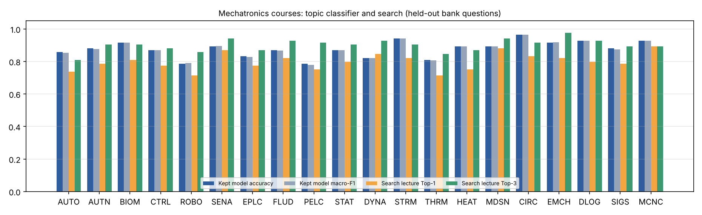

| CTRL · kept model | SENA | CIRC |
|---|---|---|
| 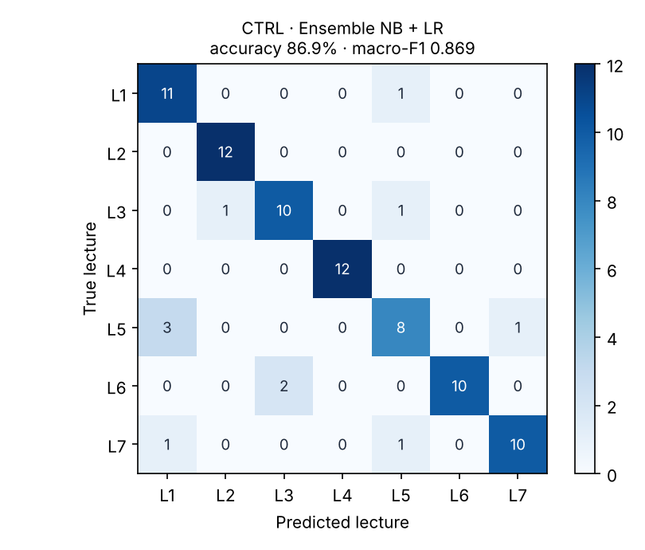 |  |  |

Chance level with 7 lectures is 14.3 %. Search counts a question as correct when the slide shown comes from the question's lecture; refused course
questions count as wrong. Choosing the model on training CV is stricter than before (it sometimes keeps a model that is not the best on the test set, e.g. SENA) but it is the honest choice.

### 3.1b Image model — which course and lecture is a slide photo from? (CNN + OCR)
2,100 slides rendered as images; 1,478 train · 202 validation · **420 test slides as phone-like photos** (tilt, crop, light, blur, JPEG).

| Model | Course (20 classes) | Lecture (140 classes) |
|---|---|---|
| November: CNN only, AI course (7 lectures, 250 pictures) | — | 26% |
| CNN only (MobileNetV2 transfer learning) | 19.8% | 4.5% |
| OCR + text model | 93.8% | 89.8% |
| CNN + OCR combined (w = 0.1) — **used** | 93.6% | 90.0% |

* **CNN:** MobileNetV2 with ImageNet weights (transfer learning) → softmax head, trained on clean + augmented photos. Every slide shares one template, so the picture alone shows only layout and figures — that is why the CNN alone stays low.
* **OCR + text:** Tesseract → TF-IDF (words + letters) → P(course) × P(lecture | course), trained on the training slides and the question banks.
* **Fusion:** log p = log p_text + 0.1 · log p_CNN (weight chosen on the validation photos). From **26 %** (November, CNN only, 7 lectures) to **90.0%** on 140 lectures.
* **On the site:** after "Ask with a photo" reads the picture, the text half says which course and lecture it comes from and offers to switch course.

| Accuracy | Combined model (course) |
|---|---|
| 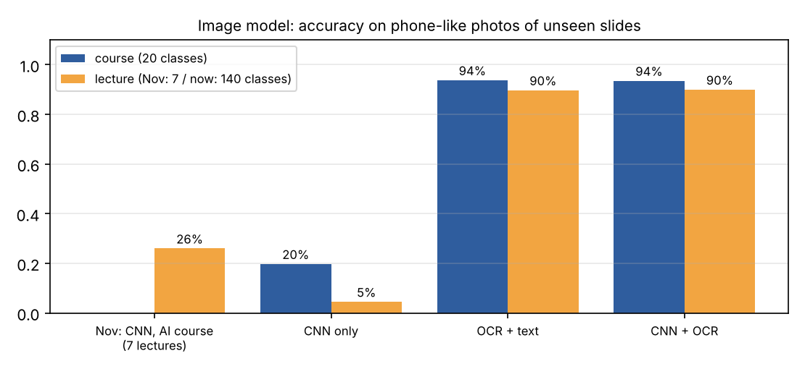 | 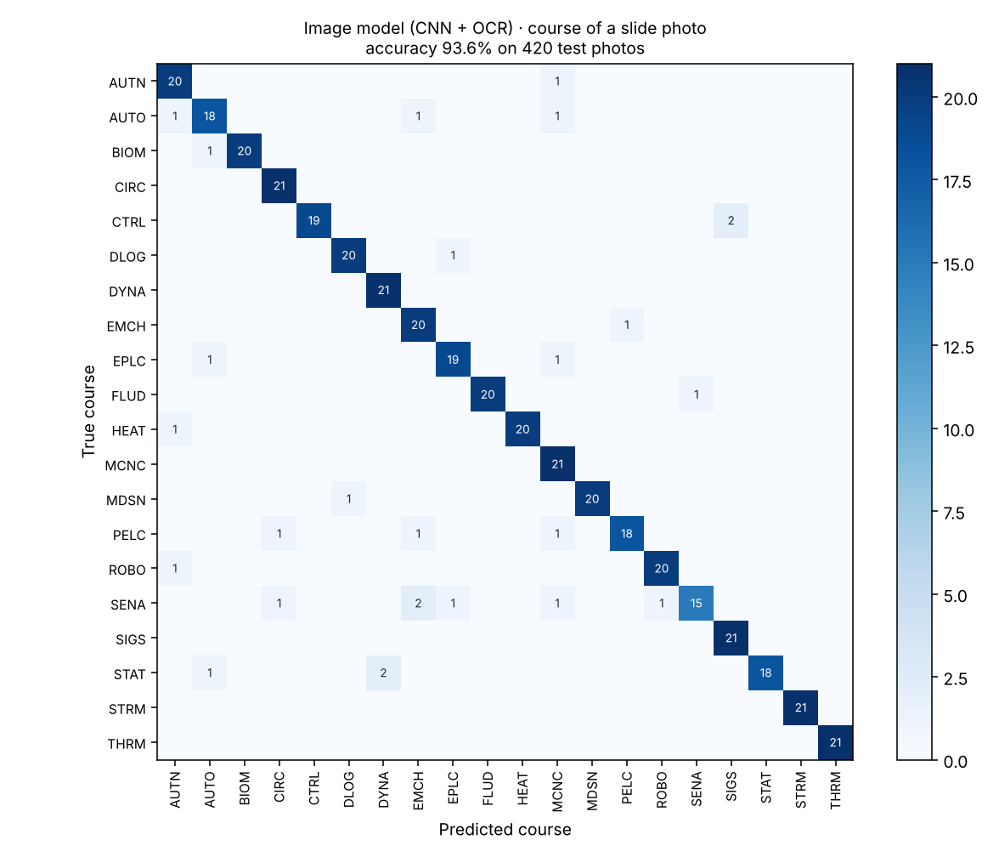 |

### 3.2 Results on the original AI course (November report)
| Measure | Result |
|---|---|
| Topic classifier, 94 held-out questions | Logistic Regression **91.5 %** (macro-F1 0.913) · Naive Bayes 84.0 % · 5-fold CV 91.2 % |
| Search, 94 hand-written questions | TF-IDF Top-1 **80.9 %** · BM25 Top-3 **90.4 %** |
| Improvement round (index expansion with student phrasings) | Top-1 75.5 % → 80.9 % |
| Off-topic | 10 / 10 required questions refused · 22 / 25 unseen refused |
| Robustness | typos 89.4 % · Arabic questions 10 / 10 |
| Image CNN (offline run, 250 pictures, 7 classes) | 26 % (chance 14 %): too few pictures per lecture — OCR is more useful than appearance |
| Ask with a photo | 6 / 6 test pictures handled (screenshot, tilted phone photo, slide photo, Arabic print, drawing without text, blurred text) |

The AI-models page of the site (main administrator, second password) shows the automatic evaluation of every course: Top-1 / Top-3 / MRR of the four search methods, the off-topic test and the history after each upload.


## 4. Features

### Student
| Feature | What it does |
|---|---|
| **Ask** | question in English, Arabic or as a **photo** (OCR; the image model also says which course and lecture the picture is from and offers to switch) → detected topic + confidence, a quick answer built only from the retrieved slides, the 3 best slides with lecture · slide and the slide image; "was this helpful?"; save the question |
| **Not found** | off-topic questions are refused with a clear message |
| **Practice** | questions per topic with two hints; every answer updates the topic level |
| **Progress** | every topic red / amber / green; "study next" with the reason; spaced reviews |
| **Study plan** | day-by-day plan from the weak topics |
| **Exam countdown** | the student sets the date of his exam (per course) → days left on the home page and the plan page; every topic below 80 % is spread over the days left and the day before the exam is a full review (falls back to the exam the doctor scheduled) |
| **Study Studio** | per lecture: flash cards, quiz, mind map, summary, key terms, videos, exams, progress, course files, ask with a photo; when the slides give fewer than 10 quiz questions the quiz is topped up from the course's question bank |
| **My files** | upload own notes / summaries / slides (PDF, Word, PowerPoint, text, photos) — after choosing, the files are listed with **Read** and **Remove** buttons → summary, terms, cards, quiz, mind map, search inside them, and notes: topics not covered, weak topics present in the files with pages to read, which lecture each file follows |
| **Exams** | choose the number of questions → random questions, timer = sum of their minutes, autosave and resume, automatic grading, result with mistakes; **when the time is over the exam closes by itself** (the page locks, saves and hands in; the clock counts to a fixed moment so a hidden tab cannot slow it; on any other page a bar shows the time left and hands the exam in at zero; reopening an expired exam grades what was saved) |
| **Backups** (every person) | archive icon in the top bar → backup page: a copy of his own data made every day he visits (last 7 kept), "make a copy now", download any copy, and a full copy with his uploaded files |
| **My courses** | 20 course cards with a search box, a clear Add / Added control and a count of the chosen courses |
| **Rafiq** (assistant) | round button on every page: "I need exams" / «عايز امتحانات» / "3ayez emtehan" → answer + button to the page; course questions go to the search; conversation saved |
| Motivation | 25 automatic badges + badges made by the doctor, day streak, notifications, calendar |
| Communication | chat (after the other side accepts), announcements, support button |
| Account | profile photo and name, password change, delete my account; Arabic / English, light / dark, phone layout |

### Doctor
| Feature | What it does |
|---|---|
| Account | request with department → approved by the main administrator; sees **only his own courses** |
| Content | upload lecture PDFs → passages, topics, index and automatic evaluation are rebuilt; videos and YouTube links |
| Exams | upload a bank (PDF / Word / Excel / CSV, Arabic and English paired by number), answer key, minutes per type, essay marks; read and export attempts |
| Data dashboard | most asked topics, lowest practice scores, students per colour, visits, **students at risk** with a reminder button, questions follow-up |
| Weekly report | per course: totals, questions the slides could not answer |
| Announcements, calendar, chat, custom badges, download the log as Excel (his courses only) |

### Main administrator (and sub-administrators with chosen permissions)
| Feature | What it does |
|---|---|
| Accounts | approve doctors, add sub-admins with 9 permission ticks, manage students, list of official course codes |
| AI models page | second password; **how the models work**, the training results of the course (NB / LR / ensemble, CV, three confusion matrices, F1 per lecture, search), the **image model** results and confusion matrices, automatic evaluation, Colab notebooks and results upload |
| Monitoring | **site visitors** (device, system, browser, country and provider from an offline GeoIP database, busiest hours; latest visits **10 per page with numbered pages**, page 1 refreshes itself every 20 s), **activity log**, support inbox (with password reset) |
| **Rafiq conversations** | every message anyone sends to Rafiq and its answer, kept permanently (the user's "new chat" only clears his window): people list, full conversations, most asked requests, messages Rafiq did not understand, Excel export — `/rafiq-log` |
| Data vault | everything about every person (own password, 20-minute timeout, every view logged) |
| **Site backups** | backup page (archive icon): copies of everything not in git, made daily and on demand; download, delete, put back (with the admin password) |
| Danger zone | scheduled deletion of chosen data or the whole site: typed sentence → choice → 10-second warning → security code → 3 h / 24 h waiting period that can be cancelled |

## 5. Workflows

| Student | Doctor |
|---|---|
| 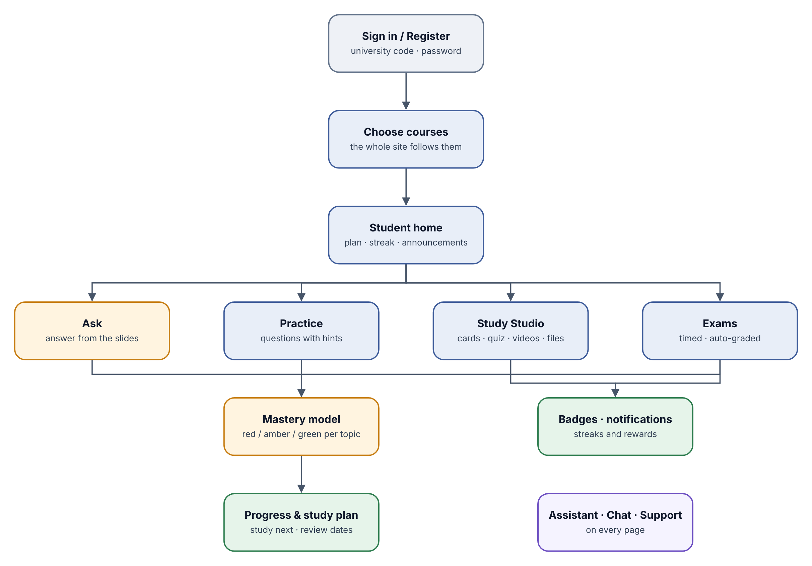 | 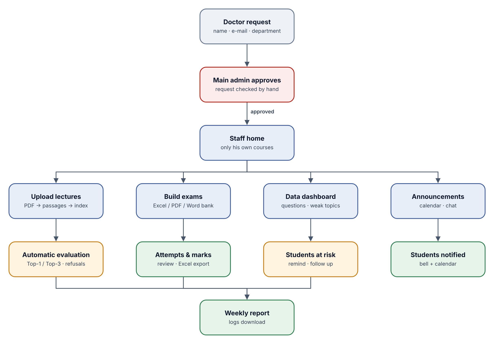 |
| **Administrator** | **Exam life cycle** |
| 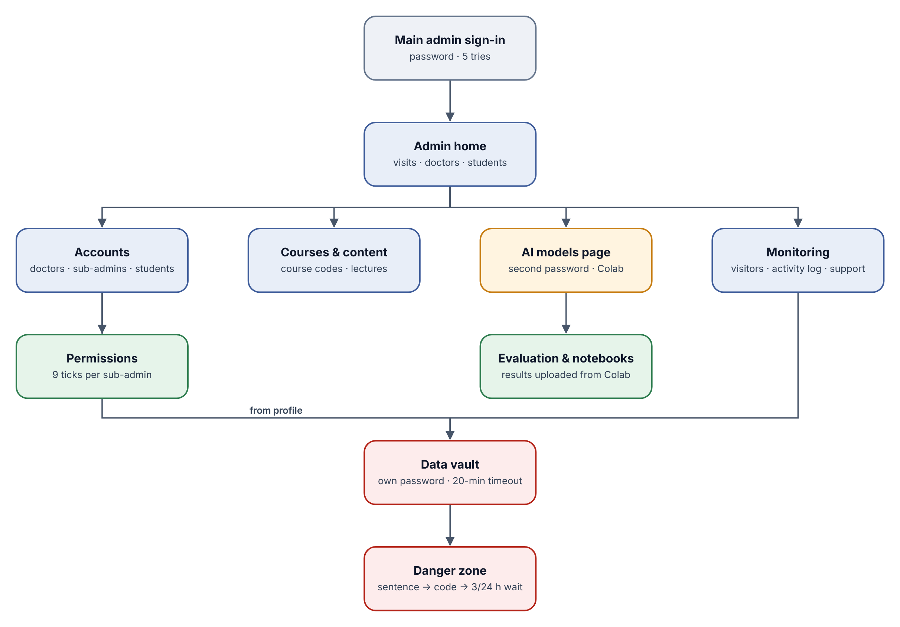 | 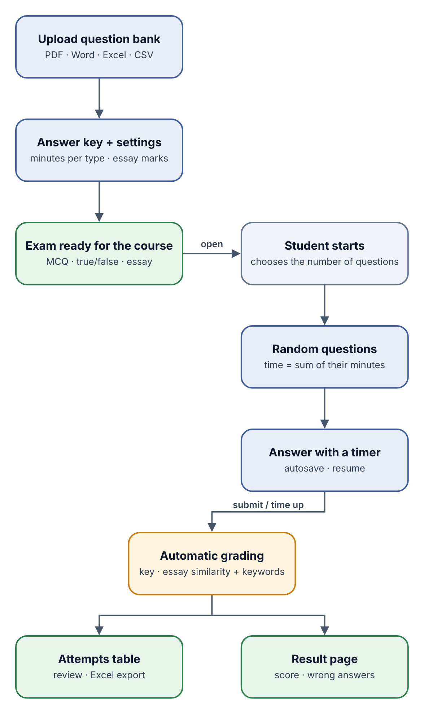 |

How Rafiq answers a message:


## 6. Architecture and technology

```
Browser (Jinja2 pages, one CSS design kit, small JS)  ──►  Flask app (app.py: routes, roles, permissions, i18n EN/AR)
                                                               │
         ┌───────────────┬───────────────┬────────────────┬────┴──────────┬───────────────────┐
     core/search     core/classifier  core/mastery    core/exams       core/assistant      core/myfiles …
   (TF-IDF, BM25,    (NB / LR topic)  (levels, study  (banks, random   (Rafiq intent        (student files)
    LSA, gate)                         next, reviews)  exams, grading)  router)
         │
   data/<CODE>/ (slides, banks, topics) · models/<CODE>/ (joblib) · logs.db (SQLite) · data/*.json (accounts, chat …)
```

| Layer | Tools |
|---|---|
| Web | Python 3, Flask, Jinja2, HTML, CSS (one design kit, RTL), JavaScript |
| Machine learning | scikit-learn, rank_bm25, joblib, fastembed (optional) |
| Documents and images | pdftotext / pypdf, Pillow, Tesseract OCR, python-docx, python-pptx, openpyxl, pandas |
| Deep learning | TensorFlow / Keras, MobileNetV2 (Google Colab) |
| Storage | SQLite (`logs.db`, imported once from the old `logs.xlsx`), JSON files, joblib models |
| Monitoring | GeoIP2Fast (offline) |
| Quality | pytest (113 automatic tests), Playwright screenshots |
| Hosting | source code on a private GitHub repository → PythonAnywhere |

## 7. How the project evolved


| Stage | Date (2026) | What changed |
|---|---|---|
| Prototypes | early Nov | demo content with TF-IDF/BM25 + classifier, experiments with local RAG models; then the real AI-course PDFs, 12 topics, first measured results |
| Design study | 9 Nov | e-learning dashboard designs compared; the "Edu" dashboard look chosen for the student home |
| **V1** | 9 Nov | the Flask app: Ask, Practice, Progress, Evaluation, Dashboard; Excel log; sign-in with a student code |
| **V2** | 9 Nov | several courses (Automotive MAM 336 from scanned PDFs with OCR), Arabic interface (RTL), dark mode, guest access, lecturer + admin merged, doctors' accounts with private codes, Google-Sheet mirror |
| Hosting | 9–11 Nov | Hugging Face Spaces (Docker became paid) → Render (needed a card) → **PythonAnywhere** |
| **V3** | 11 Nov | accounts with username + password, **exams** (bilingual banks, random timed exams, essay grading), translation, materials, support inbox, 5-try login lock |
| **V4** | 12 Nov | "Edu" design: two-panel sign-in, icon navigation, **Study Studio**, calendar, notifications, profile photo, help/FAQ |
| **V5** | 12–14 Nov | guest removed, two-step registration (university code / doctor request), chat requests and blocking, weekly report, activity log, **data vault**, **ask with a photo**, model improvement round (more tests, index expansion, leak-free threshold), final report + presentation |
| **V6** | 14 Nov | one design kit for the three sides: line icons that follow the theme, one search field, tabs, chips, empty states, micro-interactions |
| **V7** | 14 Nov | **danger zone** (scheduled, cancellable deletion), **site visitors** page |
| **V8** | 14–15 Nov | log moved from Excel to **SQLite**; **Rafiq** chat assistant (saved conversations); header menus fixed; **My files** in the Studio; analysis report, defense report and presentation |
| **Mechatronics** | 15 Nov | the seven Mechatronics courses built from the lecturer's material: 49 lectures, 2,940 bank questions, models trained and evaluated per course; repository made private |
| **V9** | 16 Nov | exam countdown, exams close themselves at time-up, studio quiz topped up from the bank, daily backups for the site and every user |
| **V10** | 16 Nov | **20 courses** (140 lectures, 2,100 slides, 8,400 questions), stronger models (slide files, ensemble, index expansion: 87.7 % / search Top-3 90.1 %), **image model CNN + OCR (90.0 % of 140 lectures)**, Rafiq conversations page, visitors paging, new course cards and upload buttons, dark-mode fixes, licence and authorship |

## 8. Problems met and how they were solved

| Problem | Solution |
|---|---|
| Pages became slow: every visit rewrote the Excel file | background writer and cached reads, then **SQLite** (one row per event, indexes) |
| Paraphrased questions missed their slide (TF-IDF matches words) | index expansion with question-bank questions and student phrasings (+5.4 pts Top-1); LSA and neural methods as options |
| The threshold looked better than it was (tuned on the questions it was reported on) | tune on training questions + half of the off-topic set, report on the rest — used again for every Mechatronics course |
| Picture-only slides could not be found | OCR of slide pictures (cached), ask with a photo |
| Free hosting cannot run heavy models | Colab as the laboratory; results uploaded to the site; graceful fallbacks |
| Hosting attempts failed (Hugging Face Docker paid, Render needs a card) | PythonAnywhere free plan, updates by `git pull` |
| `git pull` blocked by the local log file | log no longer tracked; then SQLite; one-line fix documented |
| Guest access and fake doctor accounts | real accounts with university code; doctor requests approved by the admin |
| Menus crowded, users lost; icons and fields different on every page | Study Studio, one design kit, Rafiq |
| One button could delete everything | danger zone with sentence, code, countdown and a cancellable waiting period |
| The notifications menu slid under the page's course bar | header stacking order raised above every page bar |

## 9. Security and privacy
* Passwords stored only as salted one-way hashes (Werkzeug); 5 wrong tries lock an account for 15 minutes.
* Roles and per-permission checks on every route; a doctor sees only his courses and students.
* Doctor accounts approved by hand; data vault with its own password and audit of every view.
* Files served only from known folders; student files private to their owner.
* Accounts, logs, chat, uploads and secrets are never stored in version control; the source repository is private.
* **Backups:** a daily site copy (activity log via SQLite's backup API, accounts, chats, attempts, student files …; last 7 daily + 5 hand-made kept) and a daily personal copy for every person; the main admin can download or put back a site copy (admin password, a safety copy is made first). Keep a weekly copy off the server (download → Google Drive).
* Planned: CSRF tokens on every form, a new secret key.


## 10. Limitations and future work
**Limitations** — search matches words (paraphrases with no shared words are hard; formula-heavy slides such as Robotics score lower) ·
the bank questions are written by the course team, real student questions may be harder · the image CNN needs more pictures ·
Rafiq layer 1 understands page requests, not free conversation · free hosting limits memory and outgoing connections.

**Future work** — Rafiq layer 2 with a free language model (Groq / Gemini) answering only from retrieved slides with sources ·
CSRF tokens, secret rotation and backups · import the official student list (code, name, national ID) · LTI 1.3 to open StudyMate inside Moodle and
university single sign-on · PostgreSQL, own domain and a phone app (PWA) · neural search as default and monthly retraining on real questions ·
a licence per faculty.

## 11. Every function of the website

### 11.1 Methodology: how every function is built
Every function of Masar was built with the same six steps, which is why all pages behave alike and why every function is covered by the automatic tests.

| Step | What happens |
|---|---|
| 1 · Requirement | the function comes from a real need: the project requirements, a lecturer request, or a problem seen in the activity log |
| 2 · Route + access rule | one page address with a rule that says who may open it (student, doctor, administrator, or a sub-administrator permission key); forbidden pages are never shown |
| 3 · Logic in a server module | the page only checks access and reads input; a separate module does the work and can be tested alone |
| 4 · One design kit, EN / AR | the page is built from shared components, in English and Arabic, light and dark |
| 5 · Everything recorded | questions, answers, exams, visits and staff actions go to the activity log or the audit trail |
| 6 · Automatic tests | 113 tests open every page for every role before each change is published |

Principles: answers only from the course material · small explainable models · role-based access · everything logged.

<p align="center">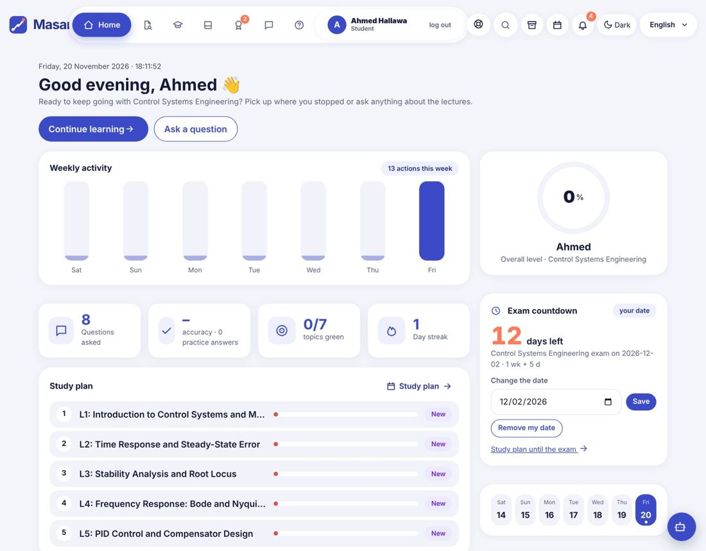</p>

*Figure 3.10: Masar: the student home page*

<p align="center">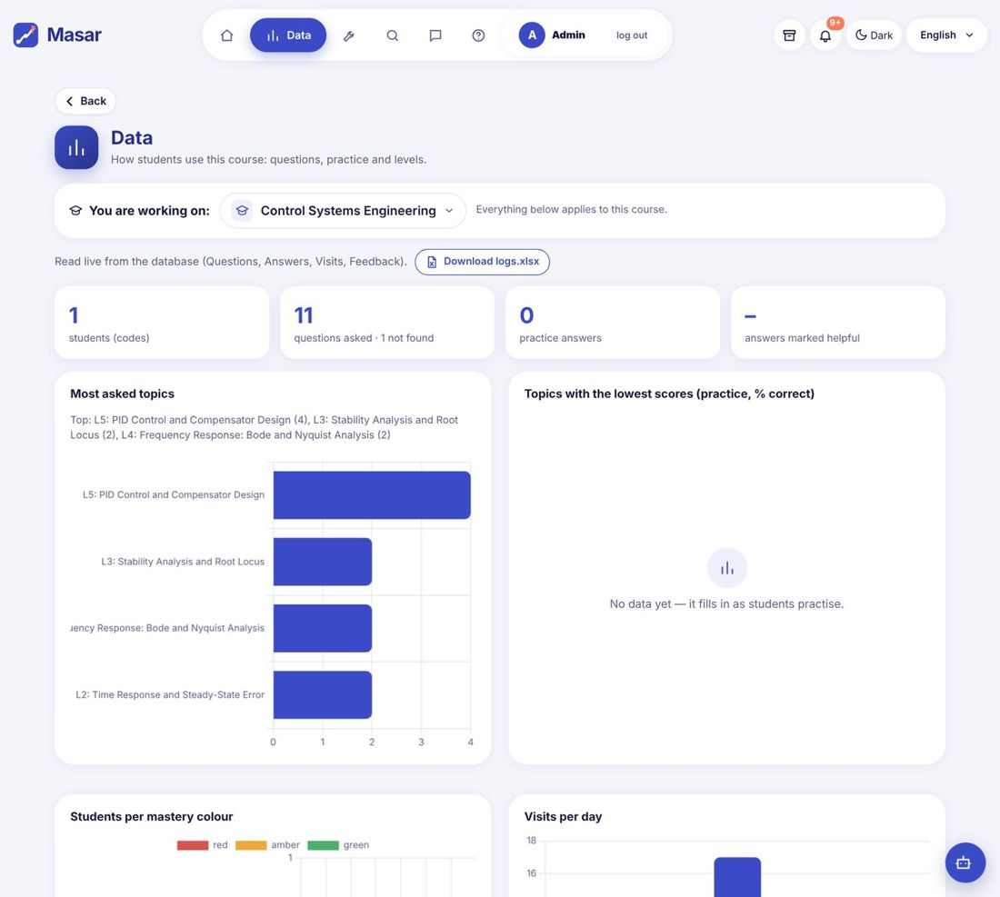</p>

*Figure 13.16: Masar: the data dashboard*

### 11.2 Who is responsible for what

| Role | Responsible for | Cannot do |
|---|---|---|
| Visitor | register (student) or request a doctor account; forgot password; write to support | open any study or staff page |
| Student | his own learning: Ask, Practice, Progress, Plan, Studio, My files, Exams; chat with accepted contacts | see others' data or staff pages |
| Doctor | his courses: lectures, videos, exam banks, schedules, announcements, his students, dashboard, weekly report, badges | other doctors' courses; manage staff; the vault |
| Sub-administrator | only the ticked keys: content, exams, badges, data, students, chat, support, doctors, announcements | anything outside his keys; vault, danger zone, AI models |
| Main administrator | the whole site: courses, doctors, admins, students, monitoring, support, Rafiq log, AI models, backups, vault, danger zone | — |

Every staff action is written to the audit trail with time and person.

### 11.3 Student functions

| Function | How it works |
|---|---|
| Ask | text, Arabic or photo → glossary / OCR → topic model → slide search + re-ranking → "Not found" gate → quick answer, topic and 3 slides with lecture · slide; "was this helpful?" vote; save |
| Practice | bank questions of a topic; up to 2 hints or reveal; level m ← m + 0.35 (outcome − m), outcome 1 / 0.7 / 0.4 / 0 |
| Progress | every topic red (< 0.40), amber or green (≥ 0.70); study next = weakest topic with green prerequisites; reviews after 1, 3 and 7 days |
| Plan + countdown | the student sets his exam date; topics below 80 % are spread over the days left (up to 90), weakest first, last day = full review |
| Study Studio | from the slides only, by extraction: summary, key terms (Excel), flash cards, quick quiz, mind map, infographic, revision slides (PowerPoint), read-aloud, videos |
| My files | own notes → passages → tagged by the course classifier → private index; all Studio tools run on them; coverage report (what is missing compared with the course) |
| Saved · Materials | bookmarked answers; lecture PDFs (one by one or ZIP) and lecture videos |
| Exams | random exam from the bank; time = sum of the minutes per question; countdown on every page; autosave; closes by itself at time-up; result with explanations |
| Badges | 25 automatic badges computed from the log (days, streaks, questions, practice, green topics) + custom badges from doctors and administrators |
| Calendar · Notifications | scheduled exams and his exam date; bell for announcements, badges, exams, chat requests and reminders |
| Chat | direct messages; the other person must accept the request first; block anybody; attach files |
| Help · Support · Rafiq | FAQ (staff can add); support message even before sign-in; Rafiq opens any page from one sentence |
| Account | register with the university code; 5 tries then a 15-minute lock; forgot password by e-mail; profile photo; EN / AR; dark mode |
| Personal backup | download a copy of his own data at any time; one automatic copy a day (last 7 kept) |

### 11.4 The exams function in detail

<p align="center">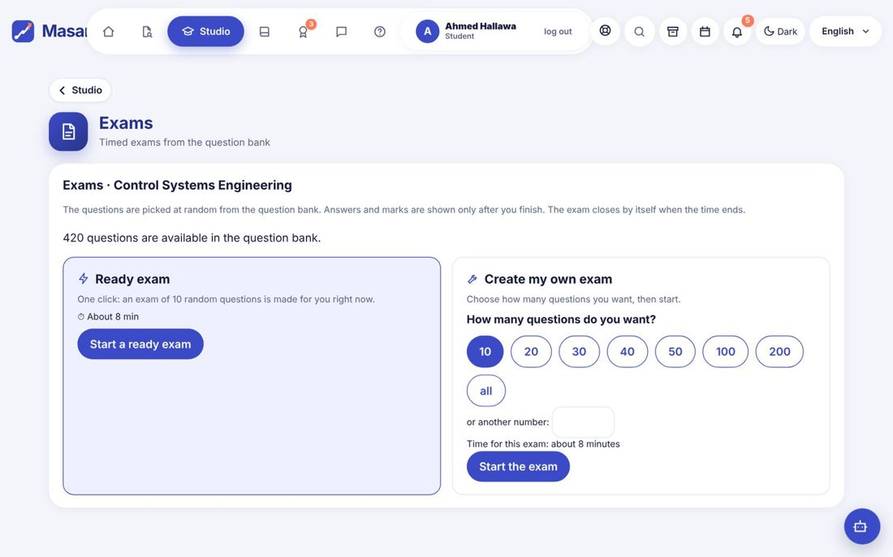</p>

*Figure 11.1: Masar: the Exams page (student)*


| Part | How it works |
|---|---|
| Bank | the doctor uploads PDF, Word, text, Excel or CSV ("Q1. …", "A) … B) …", "Answer: B"); English and Arabic versions paired by number; an Excel template is offered |
| Types | multiple choice · true / false · essay (model answer + keywords) |
| Settings | minutes per type: 1 · 0.5 · 5; essay similarity: full ≥ 0.45, half ≥ 0.25 |
| Create | the student picks the number of questions → random draw → time limit = sum of the minutes |
| Take | countdown on every page; answers saved while typing |
| Close | at time-up the page hands itself in; an exam left open is graded by the server after the deadline |
| Grade | choice questions by the key (option index, so independent of the language); essays: the better of keywords (≥ 0.7 / ≥ 0.4) and similarity |
| Doctor view | all attempts, one attempt in detail, export to Excel / CSV; scheduled exams in the course calendar |

### 11.5 Doctor functions

| Function | How it works |
|---|---|
| Content | upload lecture PDFs → one passage per slide → index rebuilt → course re-evaluated automatically; delete a lecture or a course; add a new course from PDFs (topics, fill-in-the-blank bank, classifier, index) |
| Videos | recorded lectures or YouTube links → shown in the Studio and Materials |
| Exam management | bank, settings, attempts, exports; schedule an exam date in the calendar |
| Dashboard | most asked topics, lowest scores, unanswered questions (with follow-up mark), students at risk + remind button, log as Excel |
| Weekly report | activity of the week, weak topics, unanswered questions, students who need attention |
| Announcements · Students | message to all students of a course (notification); student list with search, export and delete |
| Badges · Chat · FAQ | his own badges for his students; answer chats; add help questions |

### 11.6 Administrator functions

| Function | How it works |
|---|---|
| Doctors · Admins | approve doctor requests; create doctors (generated password); create sub-administrators with 9 permission keys |
| Courses · codes | all courses; upload the official course-code Excel that doctors pick from |
| Visitors · Activity log | device, system, browser, country, busiest hours (10 visits per page); audit trail of every staff action |
| Support · Rafiq log | support inbox (open / done, password reset); every Rafiq conversation, top requests, messages not understood |
| AI models page | behind a second password: how the models work, results, confusion matrices, automatic evaluation, Colab results |
| Data vault | own password; closes after 20 minutes idle; every view logged; reset passwords; export to Excel |
| Danger zone | sentence → choice → 10-second warning → security code → deletion after 3 h or 24 h, cancellable |
| Site backups | daily site copy (last 7) + manual copies (last 5); download, delete, restore with the admin password |

### 11.7 Functions that run automatically

| Function | When |
|---|---|
| Licence guard | every request: no valid key → only the licence notice |
| Permission check | every request: sign-in, role and permission key before the page |
| Activity logging | every question, answer, exam and visit → SQLite |
| Daily backups | first request of the day: site copy; first visit of a person: personal copy |
| Exam auto-close | at the deadline: lock and grade open attempts |
| Students at risk | once a day per course: notify the doctor |
| Spaced reviews · badges | weak topics come back after 1, 3, 7 days; badges computed from the log |
| Auto-evaluation | after each upload: Top-1 / Top-3 / MRR and the off-topic test |

## 12. Organization of the work

### 12.1 Areas of work

| Area | Main responsibility |
|---|---|
| Lead and architecture | the idea, system architecture, back end and AI models, deployment, integration and review of every change |
| Course data | lecture material, question banks, topics and prerequisites |
| Front end | CSS design kit, Arabic and dark mode, page layouts |
| Testing and evaluation | test questions, off-topic sets, result tables, the 113 automatic tests |
| Documentation | report, README, help texts and user guide |
| Presentation and user test | presentation, demo video and the real-user test protocol |

**How the idea was built, step by step:** experiments with TF-IDF, BM25 and a topic classifier (early November) → a five-page Flask prototype (9 November) → the architecture (109 routes, 56 server modules, roles and 9 permission keys) → the AI models (search with index expansion, the "Not found" gate, the cross-validated topic classifier, the mastery model and plan, the CNN + OCR image model on Colab) → one data pipeline for all twenty courses → safety and ownership (hashed passwords, audit trail, vault, danger zone, backups, licence key) → deployment on PythonAnywhere.

**Stages of the interface:** V1 plain Flask (9 Nov) → V2 Arabic right-to-left and dark mode (9 Nov) → design study, "Edu" look chosen (9 Nov) → V4 Edu dashboard design (11–12 Nov) → V6 one CSS design kit with line icons (14 Nov) → V8–V10 polish, phone layout, dark-mode contrast (14–16 Nov) → V11 Masar identity, Indigo Route palette and logo on all 56 pages (16 Nov).

### 12.2 Phases

<p align="center">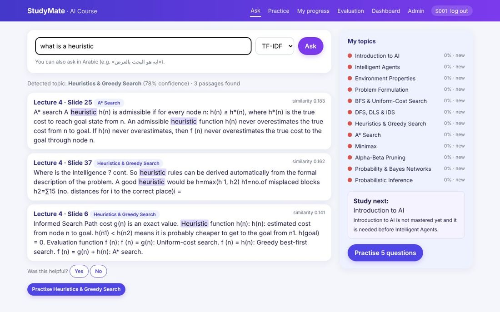</p>

*Figure 3.2: Version 1: the Ask page with the detected topic and three slides*

<p align="center">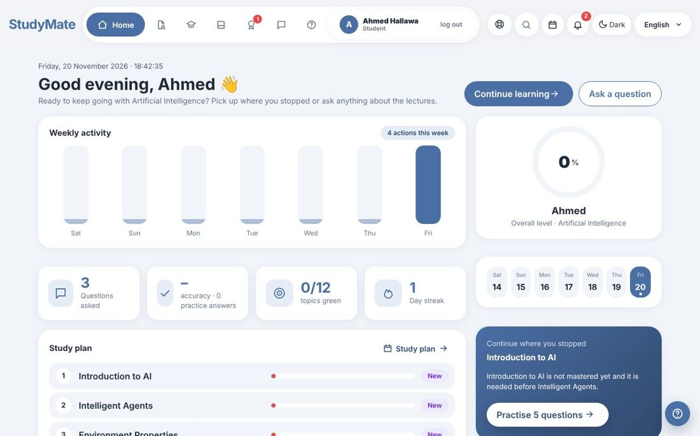</p>

*Figure 3.4: StudyMate (slate-blue palette): the student home page*


| Phase | Dates (2026) | Output |
|---|---|---|
| 1 · Requirements and design | 9 Nov | requirements mapped to features; dashboard designs compared, "Edu" look chosen |
| 2 · Prototype | 9 Nov | Flask V1: Ask, Practice, Progress, Evaluation; first deployment |
| 3 · Multi-user system | 9–12 Nov | accounts, exams, Arabic, dark mode, Study Studio (V2–V4) |
| 4 · Consolidation | 12–15 Nov | design kit, SQLite, Rafiq, data vault, backups (V5–V8) |
| 5 · Scale and models | 15–16 Nov | 20 Mechatronics courses, stronger models, CNN + OCR, rename to Masar (V9–V11) |
| 6 · Delivery | 17–21 Nov | report, presentation, demo video, licence, final review |

### 12.3 Working rules for every change
1. Make the change on the laptop in one small, separate step.
2. Run the 113 automatic tests; nothing is published while a test fails.
3. Commit with a clear message and push to the private GitHub repository.
4. Add a dated line (Cairo time) to the change log (§17).
5. Update the live site and check the changed page.
6. Update the documents that describe the change.

### 12.4 How the code and data are organized (described, not published)

| Part | What it holds |
|---|---|
| web application | page addresses (109), roles, permission keys, request guards |
| configuration | paths, list of courses, settings, time zone |
| server modules (56) | search, classifier, mastery, plan, exams, studio, assistant (Rafiq), backup, vault, visitors, licence … |
| page templates (56) | one base layout and shared parts |
| static files | CSS design kit, icons, logo, model reports and charts |
| one data folder per course | slides, passages, topics, question banks |
| one model folder per course | the trained models of the course |
| scripts and notebooks | build, train and evaluate; Google Colab notebooks |
| tests | 113 automatic tests |

Three principles: pages never contain logic (a page checks access, calls a module and shows a template) · adding a course = one data folder + one automatic build, no code change · accounts, logs, uploads and secrets never enter the repository and are backed up daily by the site.

## 13. Deployment: from the laptop to a live site

**The path of the code:** develop and test on the laptop → push to a private GitHub repository → the server pulls it → users reach it over HTTPS at <https://ahmedhallawa.pythonanywhere.com>. Heavy training (the CNN) runs on Google Colab and only the trained files travel through GitHub. Private data and the licence key live only on the server.

<p align="center">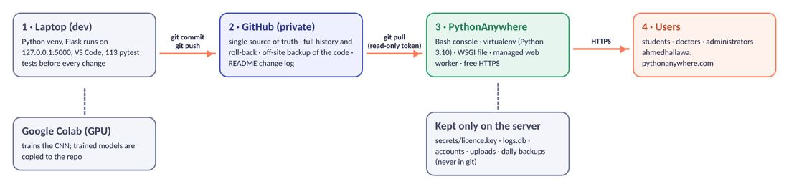</p>

*Figure 20.1: The deployment pipeline: laptop → GitHub → PythonAnywhere → users*

<p align="center">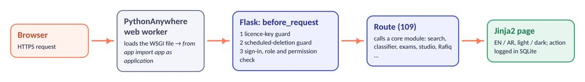</p>

*Figure 20.2: How one request is served on the server*

### 13.1 Why GitHub

| Reason | What it gives the project |
|---|---|
| Version control | every change is a commit with date, time and message: 120+ changes can be read, compared and undone |
| Single source of truth | the laptop, the server and every reviewer get exactly the same code from one place |
| Deployment channel | the server updates itself with one command (`git pull`); no manual copying, no forgotten file |
| Off-site backup | if the laptop or the server is lost, the code and the models are still on GitHub |
| Privacy and ownership | private repository with a licence; the server reads it with a read-only token |
| Documentation | README with a dated change log, screenshots and results; this public page |

### 13.2 Choosing where to host

| Option | What happened | Decision |
|---|---|---|
| Laptop + Cloudflare Tunnel | works only while the laptop is on and online | rejected: not available 24 h |
| Hugging Face Spaces (Docker) | Docker Spaces needed a paid plan | rejected: cost |
| Render (free web service) | asked for a payment card; free disk wiped on every restart; sleeps after 15 min | rejected: accounts and logs would be lost |
| **PythonAnywhere (free)** | persistent 512 MiB disk, Python pre-installed, free HTTPS, no card, made for Flask (WSGI) | **chosen** |
| VPS / Railway (paid) | full control, more disk; needs gunicorn, nginx and administration | kept for later (scaling) |

Rule: accounts, logs and exams must survive restarts, so a persistent disk is required.

### 13.3 Setting up PythonAnywhere (seven steps)
1. Clone the private repository in a Bash console (shallow clone, read-only token).
2. Create a virtual environment with Python 3.10 and install the requirements.
3. Web tab → *Add a new web app* → **Manual configuration** (the Flask quick-start template would create a new empty app; Masar already exists).
4. Set the source folder, the working folder and the virtual-environment path.
5. Edit the WSGI file, which connects the server to the Flask application.
6. Put the secrets on the server only: passwords, the secret key, the licence key.
7. Reload → the site is live with HTTPS.

### 13.4 Running the live site

| Topic | How it is handled |
|---|---|
| Update cycle | laptop: tests → push; server: pull → Reload; about one minute per release |
| Secrets and configuration | environment variables on the server; licence key in a private folder; nothing secret in GitHub |
| Private repository | the server uses a read-only fine-grained token, so it can fetch but never write |
| Disk quota 512 MiB | shallow, sparse checkout: no old history, no video or PDFs on the server |
| Data safety | daily automatic site backup + 5 manual; restore from the admin page; SQLite backup API |
| Keeping it alive | free plan: "Run until 1 month from today" pressed monthly; error and server logs on the Web tab |

### 13.5 Deployment problems and how they were solved

| Problem | Solution |
|---|---|
| Hugging Face Docker became paid; Render needed a card and lost the disk | moved to PythonAnywhere (free, persistent disk) |
| `git pull` stopped after the repository was made private | read-only fine-grained GitHub token on the server |
| disk quota (512 MiB) exceeded by history, video and presentations | fresh shallow + sparse clone; heavy files kept off the server |
| TensorFlow too large for the free host | CNN trained on Colab; the site runs the OCR + text half of the image model |
| pull refused because of the old Excel log | log moved to SQLite; file untracked; one-time backup-and-restore |
| browser kept old CSS after an update | Reload + hard refresh (Ctrl + Shift + R) |
| no outgoing internet on the free plan (neural model download) | neural search made optional; TF-IDF stays the default |

## 14. Results files in this repository

| Folder | What it holds |
|---|---|
| [results/&lt;CODE&gt;/](results/) (20 courses) | `training_metrics.json` (accuracy, macro-F1, cross-validation of Naive Bayes, Logistic Regression and the ensemble, search Top-1 / Top-3), `auto_metrics.json` (automatic evaluation of the four search methods and the off-topic test), confusion matrices (`confusion_matrix_nb.png`, `_logreg.png`, `_ens.png`) and `per_class_f1.png` |
| [results/image_model/](results/image_model/) | accuracy chart, confusion matrices (CNN only and CNN + OCR) and `metrics.json` of the image model |
| [results/mechatronics_summary.png](results/mechatronics_summary.png) · `.json` | accuracy of all twenty courses side by side |
| [results/AI_course/](results/AI_course/) | results of the original Artificial Intelligence course (November report): metrics, confusion matrices, "Not found" threshold chart |
| [screenshots/](screenshots/) | screenshots of the site (student, doctor, administrator, Arabic, dark mode, phone) and the workflow diagrams |
| [assets/](assets/) | logo, workflow diagrams and the figures used in this page |

<p align="center"></p>

<p align="center"> 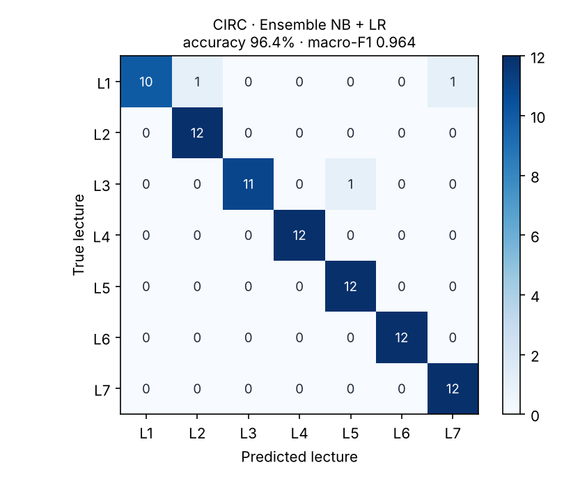</p>

Course codes: AUTO Automotive Engineering · AUTN Autonomous Systems · BIOM Biomechatronics · CTRL Control Systems · ROBO Robotics · SENA Sensors and Actuators · EPLC Embedded Systems and PLC · FLUD Fluid Mechanics · PELC Power Electronics · STAT Statics · DYNA Engineering Dynamics · STRM Strength of Materials · THRM Thermodynamics · HEAT Heat Transfer · MDSN Machine Design · CIRC Electric Circuits · EMCH Electrical Machines · DLOG Digital Logic Design · SIGS Signals and Systems · MCNC Manufacturing and CNC.

## 15. The report in pictures

Every figure of the technical report ([Masar_Report_V1.pdf](Masar_Report_V1.pdf)), with its caption and explanation, chapter by chapter. The images are in [assets/report/](assets/report/).

### Chapter 1 — Introduction

<p align="center">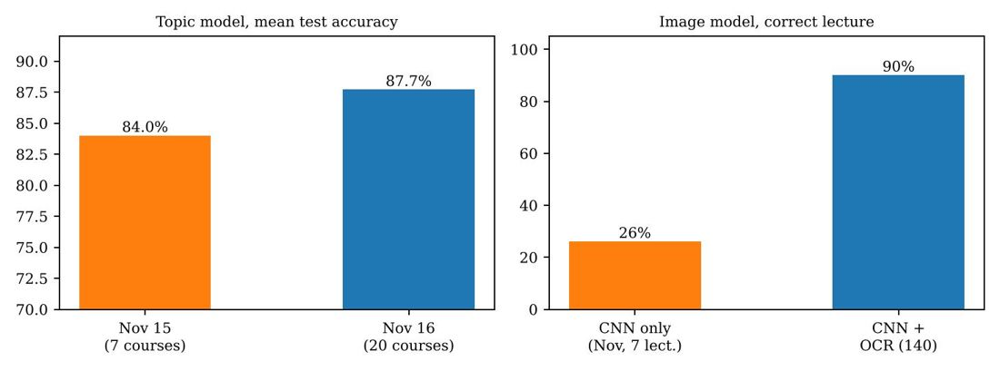</p>

**Figure 1.1:** Measured gains between the November version and the final Masar version  
The left panel shows the mean topic accuracy before and after the 16 November improvement round; the right panel shows the image model. The large improvement of the image model comes from combining the pixel-based CNN with the text read from the photo (Chapter 9), not from a larger network.

### Chapter 3 — Evolution of the System: from Flask Prototype to Masar

<p align="center">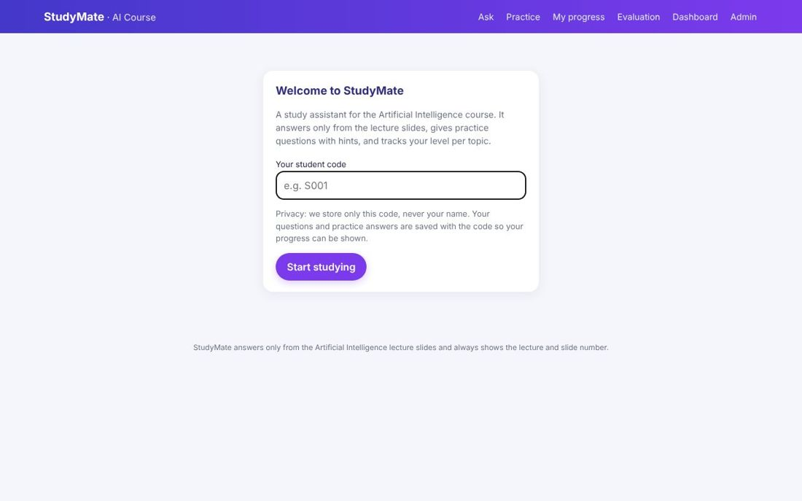</p>

**Figure 3.1:** Version 1: the first sign-in page (student code only)  
The page asks only for a student code. There were no passwords: the privacy note explains that the code is stored with the questions so that progress can be shown. This was enough for a prototype but not for a real course, which is why accounts were added on 11 November.

<p align="center"></p>

**Figure 3.2:** Version 1: the Ask page with the detected topic and three slides  
The result page of the first version already shows the pieces that remain in Masar: the detected topic with its confidence (78 % in this example), the number of passages found, and for each slide the lecture and slide number, a topic label, a similarity score and the matched words highlighted. The right-hand panel lists the twelve topics with the student’s level (all at 0 % because nothing was practised yet) and the “Study next” suggestion.

<p align="center">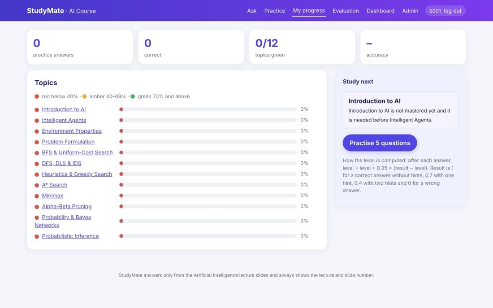</p>

**Figure 3.3:** Version 1: the Progress page  
Progress shows four counters (practice answers, correct answers, topics green, accuracy) and one bar per topic. The colour legend (red below 40 %, amber 40–69 %, green 70 % and above) and the explanation of how the level is computed are the same rules that are implemented today in core/mastery.py (Chapter 8).

<p align="center"></p>

**Figure 3.4:** StudyMate (slate-blue palette): the student home page  
The home page of the StudyMate era gathers what a student needs at a glance: a greeting, a weekly activity chart, a profile ring, a week calendar, the study plan, the weak topics and the shortcut to continue where he stopped. The slate-blue palette and the capsule navigation bar date from 12 November.

<p align="center">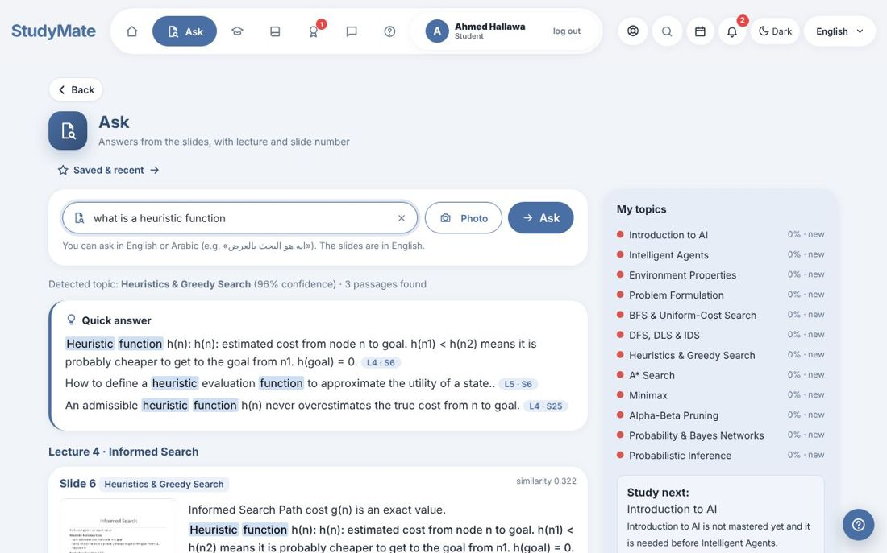</p>

**Figure 3.5:** StudyMate: an answered question  
A question inside the course returns the quick answer, the detected topic and the best slides with their pictures. The slide image is rendered from the lecture PDF so that the student sees the original slide, not only extracted text.

<p align="center">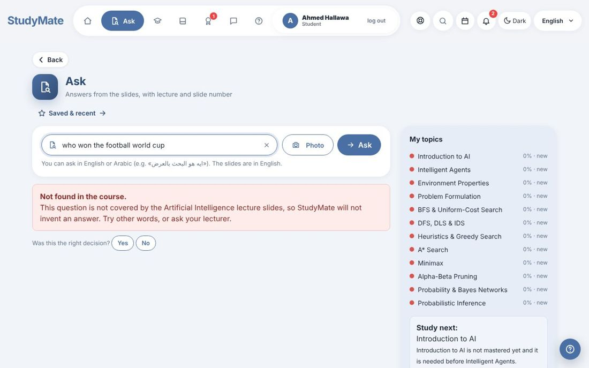</p>

**Figure 3.6:** StudyMate: a question outside the course is refused  
For an off-topic question the system displays the “Not found in the course” message instead of returning the least bad slide. This is requirement 6 of the project sheet.

<p align="center">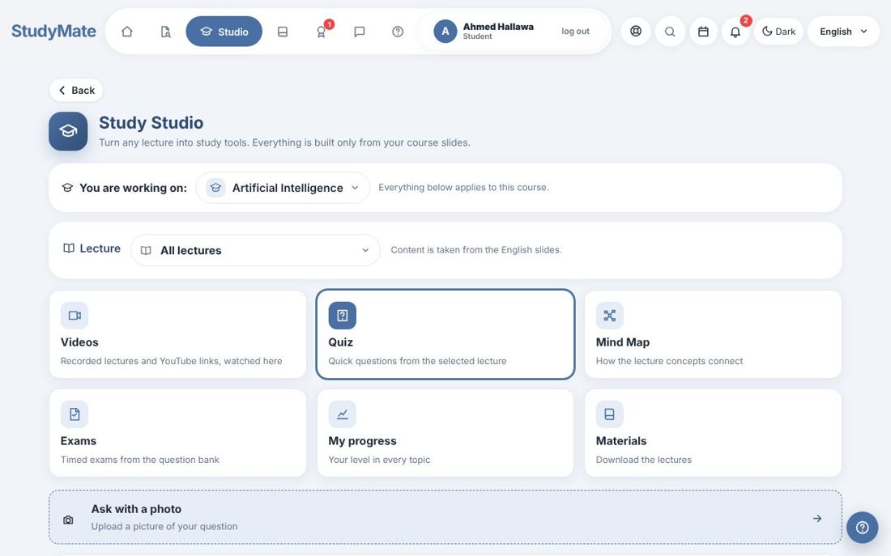</p>

**Figure 3.7:** StudyMate: the Study Studio hub  
The Study Studio (introduced on 12 November) builds study aids from the slides. In this screenshot the tiles are Videos, Quiz and Mind map, with Exams, My progress and Materials as shortcuts, and a button to ask with a photo; the summary report, flash cards, terms table, infographic and read-aloud function are in the same hub. Everything is derived from the slides, nothing is generated from outside knowledge.

<p align="center">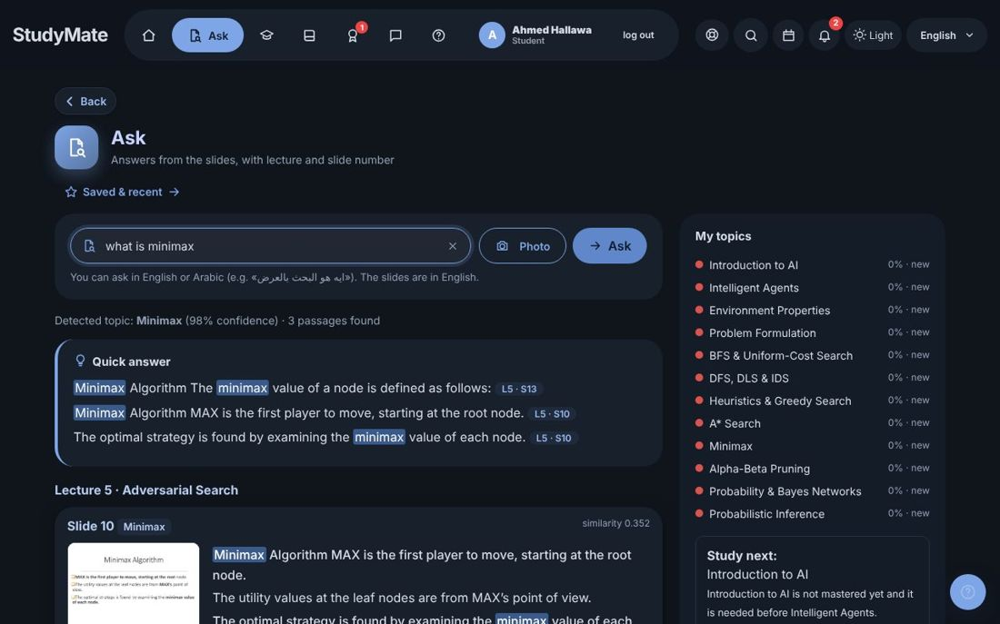</p>

**Figure 3.8:** StudyMate: the dark theme  
The dark theme is chosen from the header and remembered per browser. In V10 several dark-mode contrast problems were corrected.

<p align="center"></p>

**Figure 3.9:** The Masar logo (light version, shown here in grey scale)  
The icon is a rounded square containing a path that rises through three waypoints and ends in a flag. The Arabic word مسار is set beside the Latin name. The coral flag is the only accent colour, which is why the palette is called “Indigo Route”.

<p align="center"></p>

**Figure 3.10:** Masar: the student home page  
The same page in Masar. The structure is unchanged, the palette and logo are new. The cards show the exam countdown that the student sets himself, the plan that spreads weak topics over the days left, and the course chips for switching course.

<p align="center">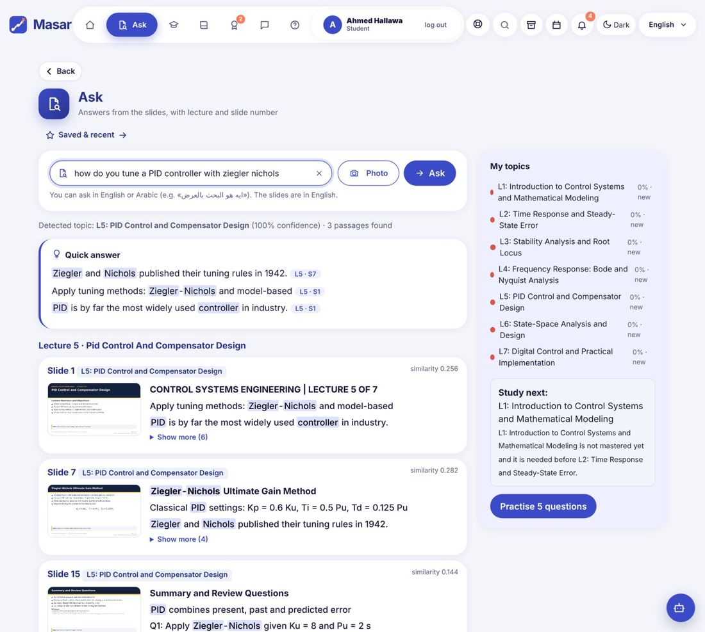</p>

**Figure 3.11:** Masar: an answered question  
The Ask page of the final version: topic and confidence, quick answer, the three best slides (lecture · slide) with the slide picture, the best sentence with a “show more” control, and the “was this helpful?” feedback that goes to the doctor’s report.

<p align="center">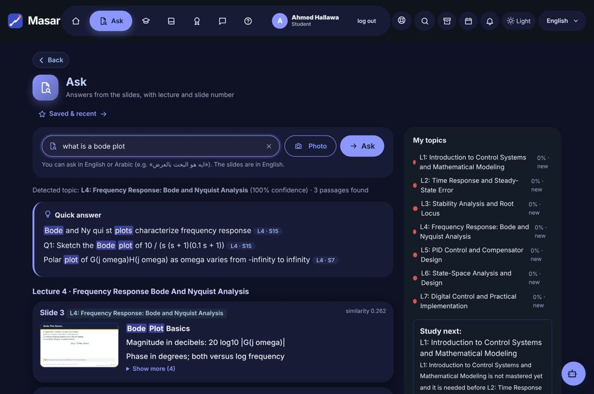</p>

**Figure 3.12:** Masar: the dark theme  
The same student home page in dark mode. The mode is chosen with the moon / sun button in the header and remembered by the browser; every page and every component of the design kit has a dark version.

### Chapter 4 — System Architecture

<p align="center">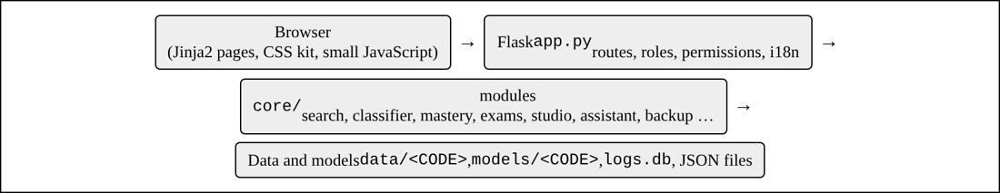</p>

**Figure 4.1:** Request flow of the application  
The browser never talks to the models directly: every question goes through a Flask route that first verifies the user, then calls the relevant core module, and finally logs the event in SQLite. Because the models are small, loading them per course on demand is fast enough for the free hosting plan.

### Chapter 6 — Slide Search and the “Not Found” Gate

<p align="center">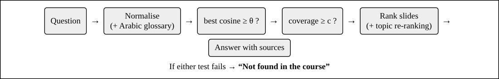</p>

**Figure 6.1:** The two-condition Not-found gate  
The gate always uses TF-IDF similarity so that its threshold θ keeps one meaning whichever ranking method the student selects. θ and c are chosen per course by a grid search on training questions (which must pass) and half of the off-topic set (which must be refused); the other half of the off-topic set is used only for reporting.

<p align="center">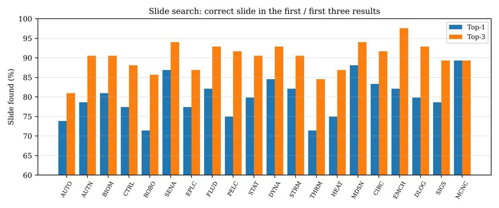</p>

**Figure 6.2:** Search accuracy for each of the twenty courses  
Every course is evaluated separately because every course has its own index. The Top-3 value is consistently about ten points above Top-1, which means that in most failures the correct slide is still on the screen, just not first. The differences between courses reflect how much the slides of a course repeat the same vocabulary (for example, courses with many lectures sharing equations are harder than courses with distinctive terms).

<p align="center">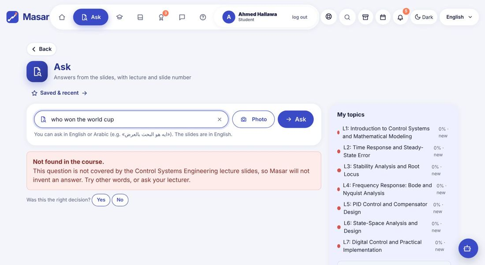</p>

**Figure 6.3:** Masar: the “Not found” message for an off-topic question  
The refusal is explicit and does not show any slide, so the student never receives a misleading answer. For the doctor, every refused question is listed in the weekly report as “questions the slides could not answer”, which tells him what to add to the course.

<p align="center">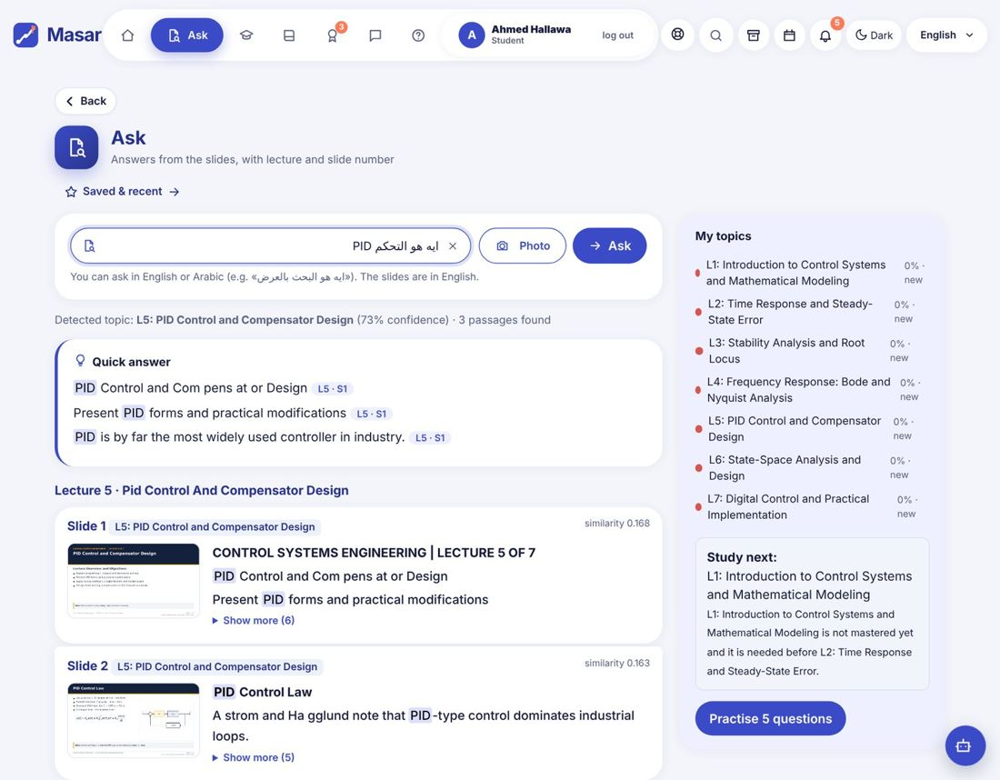</p>

**Figure 6.4:** Masar: an Arabic question  
An Arabic question is translated to English slide terms by the glossary, searched, and answered with the same slide results. The interface is right-to-left. The topic and the confidence are shown in the student’s language.

### Chapter 7 — Topic Classification

<p align="center">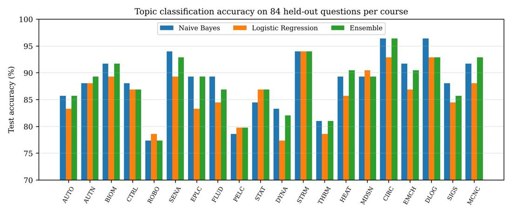</p>

**Figure 7.1:** Test accuracy of the three classifier kinds on the twenty courses  
Each group of bars is one course. The three kinds are close for most courses, which shows that the features matter more than the model. The kept model is the cross-validation winner, not necessarily the tallest bar here, which is why the mean of the kept models (87.7 %) can differ slightly from the mean of the best bars.

<p align="center">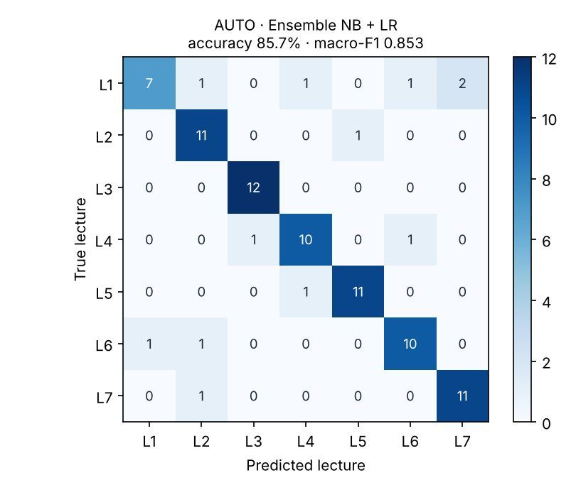</p>

**Figure 7.2:** Confusion matrix of the ensemble for the Automotive Engineering course (AUTO)  
Rows are the true lectures and columns the predicted lectures; the diagonal shows correct predictions. Errors concentrate between neighbouring lectures that share vocabulary, which is expected because lecture n builds on lecture n−1. The matrix lets the lecturer see which lectures students (and the classifier) confuse.

<p align="center">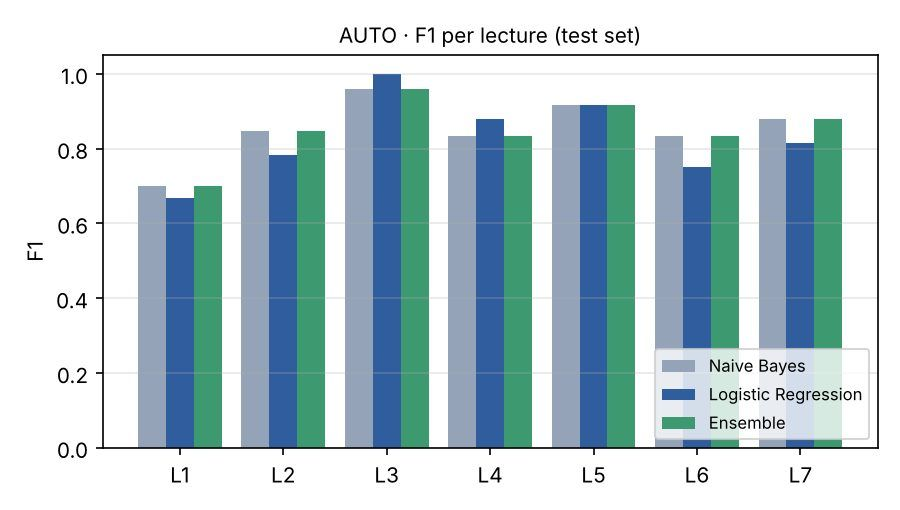</p>

**Figure 7.3:** F1 score per lecture for the three classifiers (AUTO)  
The F1 score combines precision and recall. A lecture with a low F1 in all three models is a lecture whose slides are not distinctive; it is a candidate for rewriting or for additional slides.

<p align="center"></p>

**Figure 7.4:** Confusion matrix of Naive Bayes (AUTO)  
Rows are the true lectures of the held-out questions and columns the lectures predicted by Naive Bayes. The diagonal holds the correct predictions; the few errors fall between neighbouring lectures that share vocabulary.

<p align="center">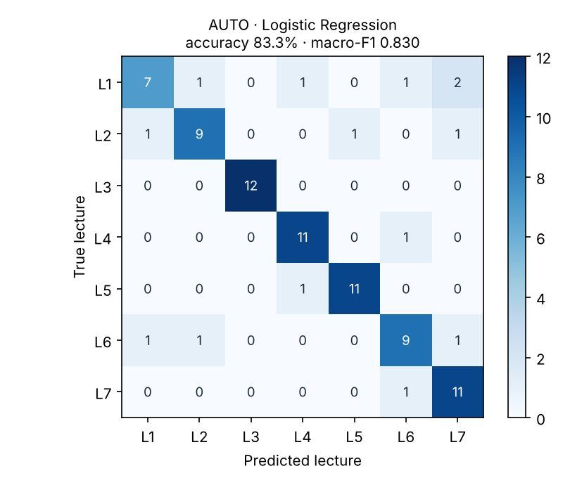</p>

**Figure 7.5:** Confusion matrix of Logistic Regression (AUTO)  
The three matrices for the same course are shown so that the effect of the model type can be compared; all matrices for all twenty courses are in static/reports/<CODE>/ and in the AI-models page of the application.

### Chapter 8 — Student Model: Mastery, Study Next and Plan

<p align="center">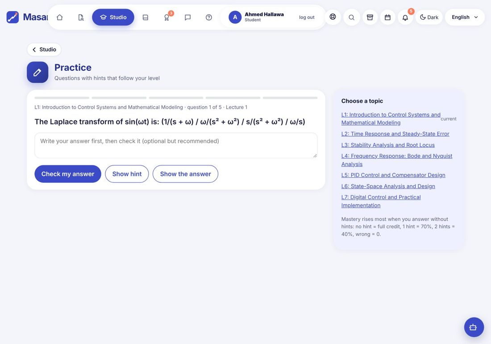</p>

**Figure 8.1:** Masar: Practice mode with a question and hints  
The screenshot shows a multiple-choice question, the buttons for the two hints and the answer choices. After an answer, the topic bar in Progress moves according to the formula of the next section.

<p align="center">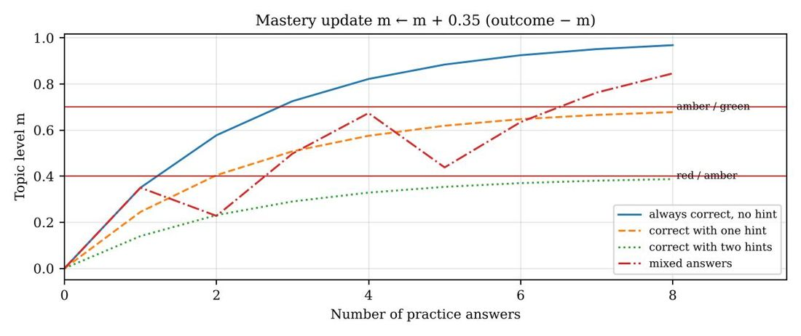</p>

**Figure 8.2:** How the topic level evolves for four answer patterns  
Always answering correctly without a hint reaches the green line (0.70) after three answers (0.35, 0.58, 0.73); answering correctly with one hint also reaches amber quickly but converges to 0.7, so a student who always needs a hint never becomes fully green; mixed answers oscillate. The coefficient 0.35 was chosen so that about three correct answers without hints move a topic from red to green.

<p align="center">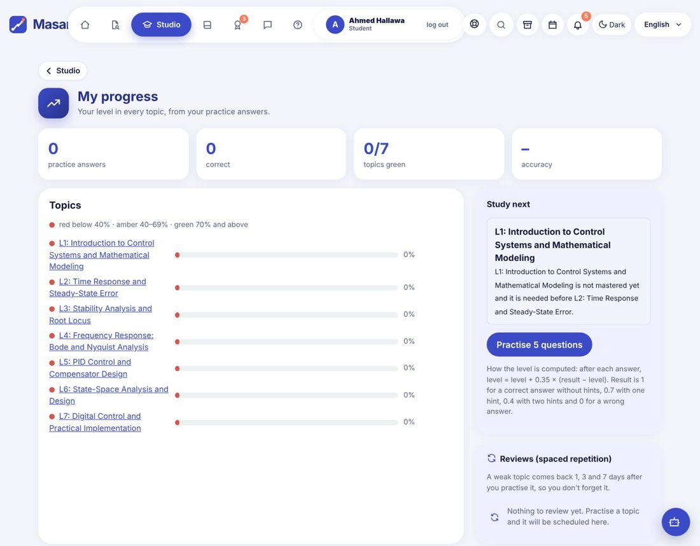</p>

**Figure 8.3:** Masar: the Progress page  
Every topic of the course is shown with its colour and percentage. Next to the list, “Study next” names one topic and explains the reason in words. The rule is: choose the weakest topic whose prerequisite topic is green; if none qualifies, choose the weakest. The prerequisite of a lecture is the previous lecture (topics.csv).

<p align="center">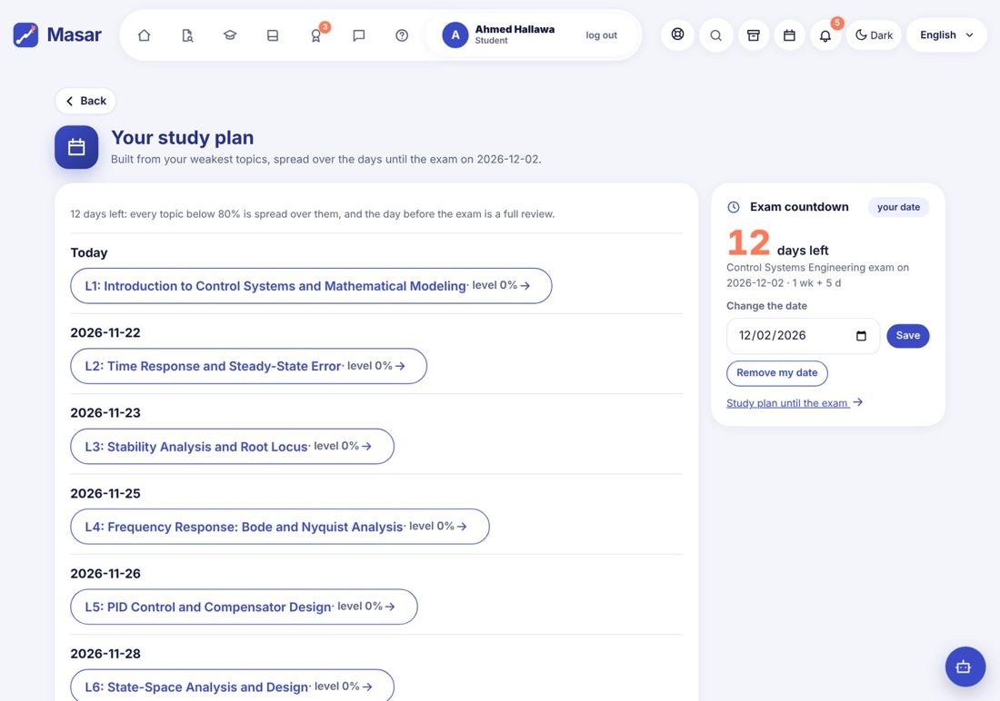</p>

**Figure 8.4:** Masar: the study plan  
The plan shows each day with its topics and their current percentage; the last day is marked as the full review. The number of days left appears as the exam countdown on the home page. Because the plan is recomputed from the levels, it changes as the student improves: topics that reach 80 % disappear from it.

<p align="center">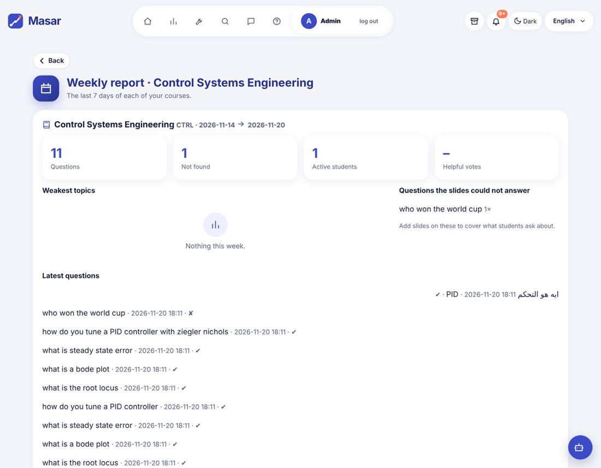</p>

**Figure 8.5:** Masar: the weekly report of one course (doctor)  
The report is a one-page summary for the lecturer: totals, the weakest topics and the questions that students asked but the slides could not answer. These last items tell the lecturer which material is missing from the slides.

### Chapter 9 — Image Recognition: CNN and OCR

<p align="center">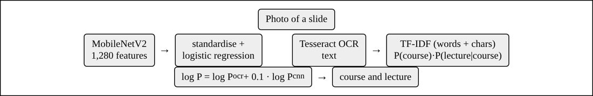</p>

**Figure 9.1:** Architecture of the final image model  
The text branch dominates (weight 1) and the CNN acts as a tiebreaker (weight 0.1) when two lectures have similar text, for example when OCR is partly wrong because of blur or perspective.

<p align="center"></p>

**Figure 9.2:** Accuracy of the four image models  
The bars show how the OCR text carries almost all the information; adding the CNN with a small weight gives a small gain in lecture accuracy (89.8 % to 90.0 %), at the cost of one slightly lower course accuracy (93.8 % to 93.6 %). The text part alone is enough for the web site, which is why the free host runs only the text half (see below).

<p align="center">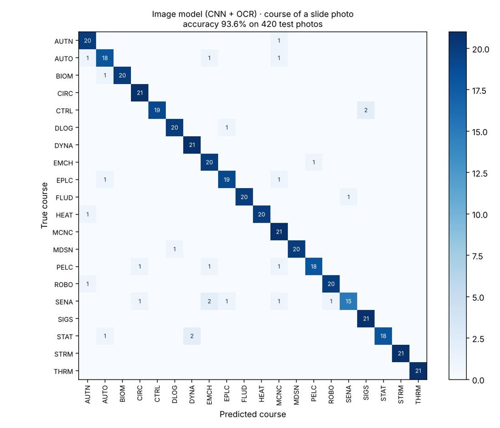</p>

**Figure 9.3:** Confusion matrix of the combined model: course of a slide photo  
Each row is a true course and each column a predicted course. Most counts lie on the diagonal. The off-diagonal values concentrate between related courses (for example Statics and Dynamics, or Electric Circuits and Electrical Machines), whose slides share vocabulary.

<p align="center">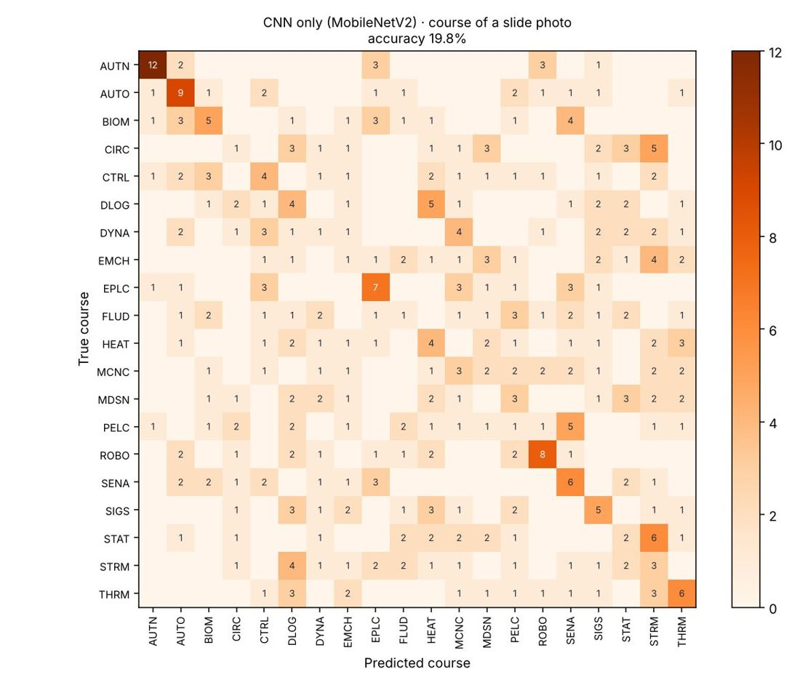</p>

**Figure 9.4:** Confusion matrix of the CNN alone: course of a slide photo  
For comparison, the CNN alone spreads its predictions widely, because all courses use the same slide template. This figure explains why the CNN could not be used alone.

<p align="center"></p>

**Figure 9.5:** Masar: My files (the same OCR reads uploaded photos of notes)  
Uploaded photos of notes are read with the same OCR (up to ten pages per file) and then summarised, indexed and compared with the course lectures.

### Chapter 10 — Rafiq: the Assistant

<p align="center">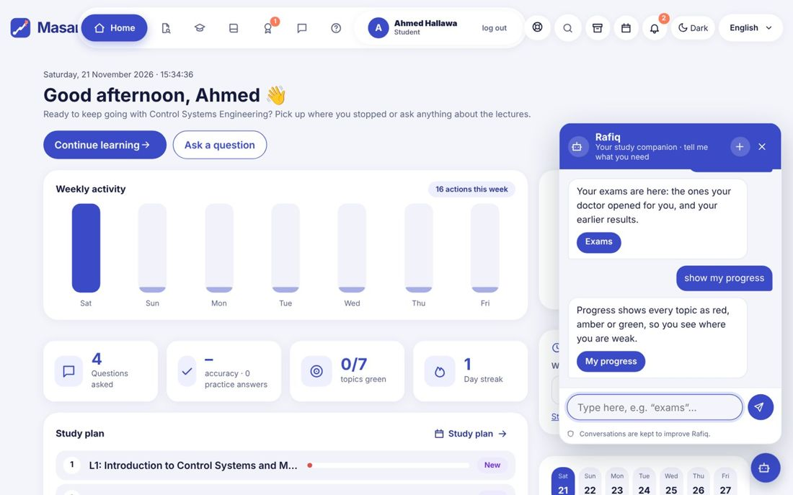</p>

**Figure 10.1:** Rafiq opened on the student home page  
Rafiq is the round button at the bottom right of every signed-in page. It opens a panel over the page, so the user does not lose his place; the panel can be closed, and the “+” button starts a new conversation.

<p align="center">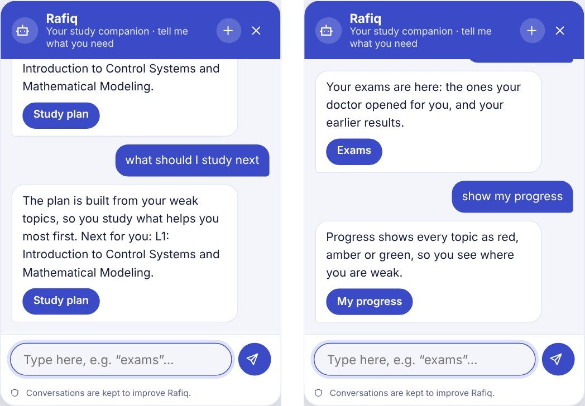</p>

**Figure 10.2:** (a) Asking what to study next  ·  (b) Opening pages by name  
(a) The student writes “what should I study next”. Rafiq reads the mastery model and the prerequisites and names the next topic (here Lecture 1 of Control Systems), then offers the Study plan button. The answer is personal: another student with other levels receives another topic. (b) Short requests such as “open my exams” or “show my progress” are matched to the Exams and Progress intents. The answer explains in one sentence what the page contains, and the button opens it.

<p align="center">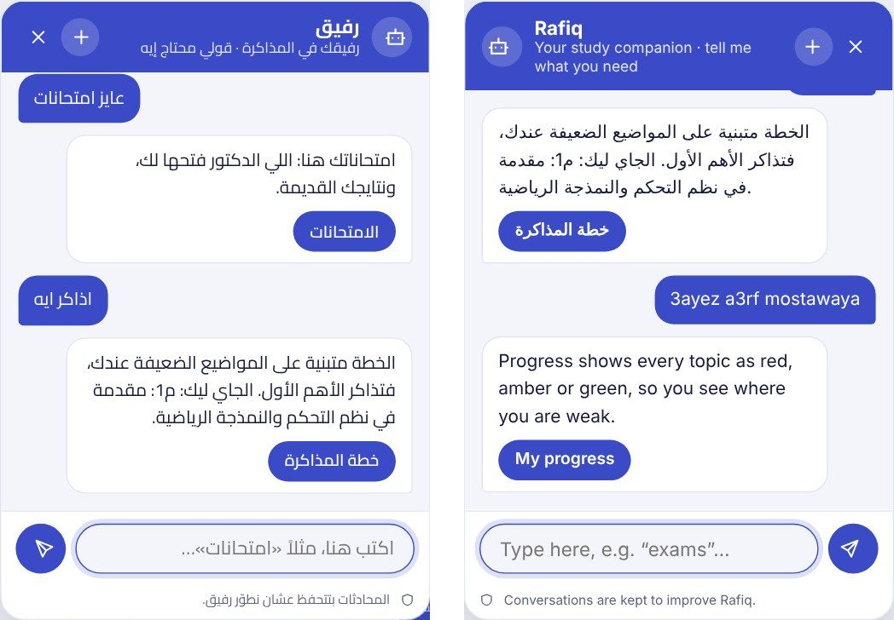</p>

**Figure 10.3:** (a) The same requests in Arabic  ·  (b) Franco-Arabic (Arabic written in Latin letters)  
(a) Written in Egyptian Arabic (“عايز امتحانات” – “I want exams”, “اذاكر ايه” – “what do I study”), the messages receive Arabic answers and Arabic buttons, and the panel switches to right-to-left. (b) Many students type Arabic with Latin letters and digits. “3ayez a3rf mostawaya” (“I want to know my level”) is recognised through Franco keywords and opens the Progress page.

<p align="center">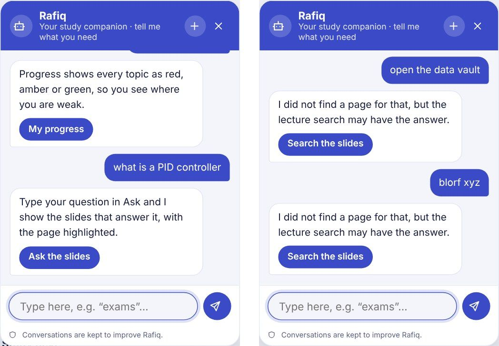</p>

**Figure 10.4:** (a) A course question is sent to the slide search  ·  (b) A forbidden or unknown request  
(a) “What is a PID controller” is a lecture question, not a page request. Rafiq does not try to answer it from its own knowledge; it offers the Ask page with the question already filled in, so the answer comes from the slides with lecture and slide number, like every answer in Masar. (b) A student asks for the data vault, which only the main administrator may open, and then types meaningless text. Because the permission filter runs before ranking, the vault is never offered; Rafiq says it found no page and proposes the slide search. Both messages are recorded as “not understood” for the administrator.

<p align="center">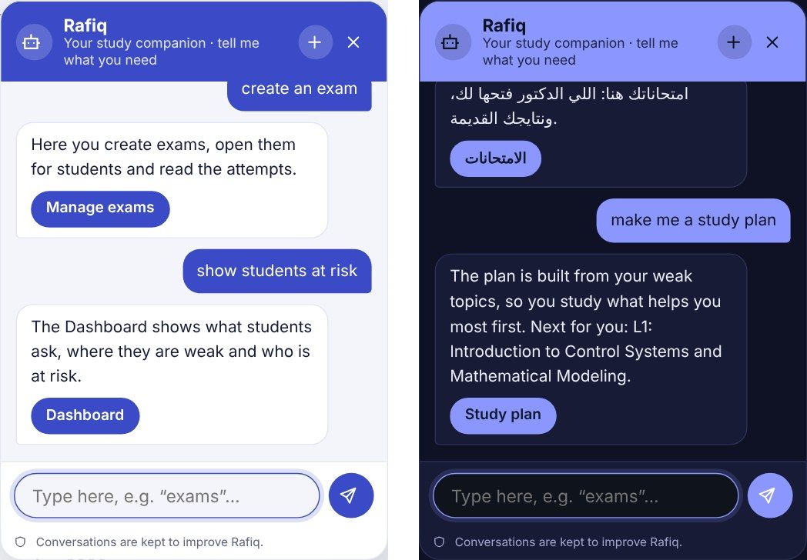</p>

**Figure 10.5:** (a) Rafiq for the administrator  ·  (b) Rafiq in dark mode  
(a) For staff the same assistant offers staff pages. “Create an exam” opens exam management and “show students at risk” opens the dashboard where weak students are listed. (b) The panel follows the theme of the site (light or dark) and the language chosen in the header.

<p align="center">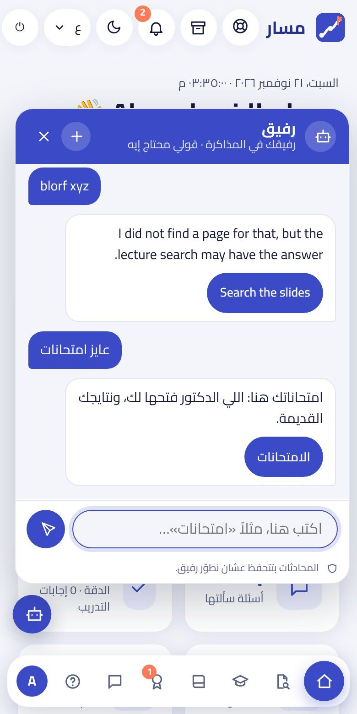</p>

**Figure 10.6:** Rafiq on a phone, in Arabic  
On phones the panel takes the full width of the screen and keeps the same behaviour.

<p align="center">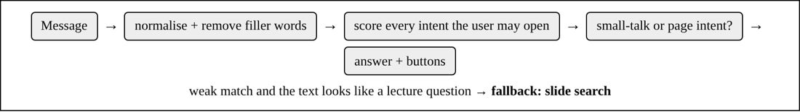</p>

**Figure 10.7:** Rafiq intent routing  
The routing is a bag-of-words score between the words of the message and the keywords of each intent. The permission filter is applied before ranking, so a forbidden page can never be offered.

<p align="center">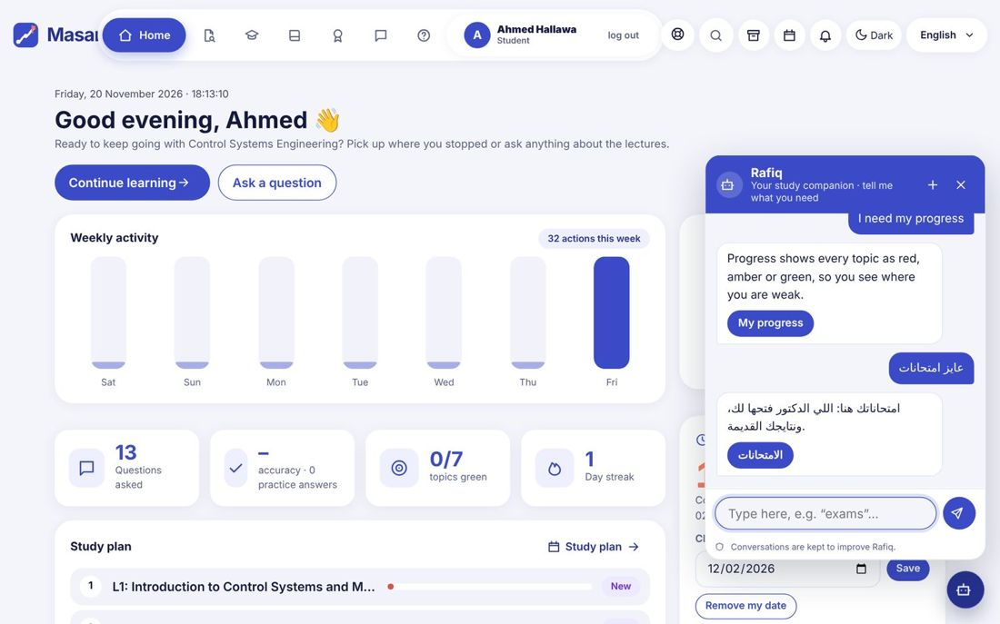</p>

**Figure 10.8:** Masar: the Rafiq panel (student)  
The panel shows the greeting, the chips of common requests and the conversation. Each answer ends with buttons; one press opens the page.

<p align="center"></p>

**Figure 10.9:** Masar: a conversation in which Rafiq opens pages  
The user asked what to study; Rafiq answered with the next topic and the Plan button. Messages in Arabic receive Arabic answers.

<p align="center"></p>

**Figure 10.10:** Masar: Rafiq for the administrator  
For staff the same assistant offers staff pages (dashboard, students, vault), still filtered by the user’s permissions.

<p align="center"></p>

**Figure 10.11:** Masar: the Rafiq conversations page (main administrator)  
The page lists people, conversations, the most requested intents and the messages Rafiq did not understand, with an Excel export. The unmatched messages show what users expect the system to do, and are the data for training the future layer 2.

### Chapter 11 — The Exam Engine

<p align="center"></p>

**Figure 11.1:** Masar: the Exams page (student)  
The student chooses how many questions he wants (10, 20, 30, 40, 50, 100, 200 or all, where the bank is big enough). The page shows the estimated time, which is the sum of the minutes of the questions that will be drawn.

<p align="center"></p>

**Figure 11.2:** Masar: exam management (doctor)  
The doctor’s page has three tabs: Questions (upload, counts, delete bank), Settings (minutes per type and essay grading limits) and Results (all attempts, export).

<p align="center"></p>

**Figure 11.3:** Life cycle of an exam attempt  
The same flow is drawn together with the actions of the doctor in the exam process figure of Chapter 13.

### Chapter 12 — Study Studio and My Files

<p align="center"></p>

**Figure 12.1:** Masar: the Study Studio hub  
The hub lists the aids and offers a shelf to the other student pages (exams, progress, materials, My files). A selector chooses a lecture or all lectures.

<p align="center"></p>

**Figure 12.2:** Masar: the summary report  
The report lists the selected sentences with their lecture and slide so that each can be checked in the original slide.

<p align="center"></p>

**Figure 12.3:** Masar: flash cards  
A card shows a term; pressing it shows the definition taken from the slides.

<p align="center"></p>

**Figure 12.4:** Masar: the quick quiz  
The quiz mixes term-matching and fill-the-gap questions built from slide sentences. Answers are marked with a letter and right/wrong animation.

<p align="center"></p>

**Figure 12.5:** Masar: the concept map  
The mind map can be exported as an image. It gives an overview of how the concepts of a lecture relate before studying the details.

<p align="center"></p>

**Figure 12.6:** Masar: key terms table  
The table of terms can be downloaded as an Excel file.

<p align="center"></p>

**Figure 12.7:** Masar: infographic cards  
The infographic turns one lecture into a single page of cards: key numbers, the main terms and the most important sentences, all taken from the slides. It is meant for a last look before the exam.

<p align="center"></p>

**Figure 12.8:** Masar: My files  
My files lists the notes the student uploaded for the current course, with the number of pages read and the topics found. Each file can be opened with the study tools (Read) or removed.

<p align="center"></p>

**Figure 12.9:** Masar: the report of an uploaded file  
The report summarises the uploaded file with its pages, terms, review time and definitions, so that the student sees what his own notes contain.

<p align="center"></p>

**Figure 12.10:** Masar: the mind map linking files and lectures  
The map shows which lectures of the course each uploaded file touches, and reveals lectures that are not covered by any file.

<p align="center"></p>

**Figure 12.11:** Masar: a quiz generated from the student’s own files  
A quick quiz built from the student’s own uploaded notes, with the same method as the Studio quiz on the slides: a key sentence is chosen and a term is hidden for the student to fill in.

### Chapter 13 — The Three Workflows

<p align="center"></p>

**Figure 13.1:** Student workflow  
The student signs in, chooses courses and lands on the home page. From there four activities (Ask, Practice, Study Studio, Exams) feed the mastery model, which in turn feeds the progress page and the study plan; activity also earns badges and notifications. The assistant, chat and support are available on every page.

<p align="center"></p>

**Figure 13.2:** Masar: the sign-in page  
The two-panel sign-in page with the Masar logo. The language and theme switches are in the header.

<p align="center"></p>

**Figure 13.3:** Masar: choosing the account type  
Registration starts by choosing student or doctor, because the two paths ask for different information.

<p align="center"></p>

**Figure 13.4:** Masar: student registration  
A student must enter the university code. Hints appear only when a rule is broken.

<p align="center"></p>

**Figure 13.5:** Masar: choosing courses (cards with search and Add / Added)  
The student chooses his courses from cards that show the course code, name and number of lectures. A search field filters the cards, and the button changes from Add to Added.

<p align="center"></p>

**Figure 13.6:** Masar: saved questions  
Saved questions: every answer the student bookmarked from the Ask page, with the question, the slide, the topic and the time. One click opens the answer again; another removes it.

<p align="center"></p>

**Figure 13.7:** Masar: badges  
The badges page shows the 25 automatic badges (days, streak, questions, practice, topics, exams, habits) and the doctor’s custom badges. Earning a badge sends a bell notification.

<p align="center"></p>

**Figure 13.8:** Masar: calendar of exams and events  
The calendar shows, month by month, the exams the doctor scheduled for the course and the exam date the student set for himself, so the study plan and the countdown match the real dates.

<p align="center"></p>

**Figure 13.9:** Masar: direct messages  
Chat is by username; the other side must accept the request first, and either side can block or close a chat. Files can be sent and read ticks are shown.

<p align="center"></p>

**Figure 13.10:** Masar: profile  
The profile page: name, e-mail, profile photo and password change. The photo appears in the header, in chat and in the staff lists.

<p align="center"></p>

**Figure 13.11:** Masar: lecture materials with download  
Lecture materials: the PDF of every lecture of the course, downloadable one by one or all together in one ZIP file, together with the lecture videos.

<p align="center"></p>

**Figure 13.12:** Doctor workflow  
A doctor requests an account; the main administrator checks the request by hand. Once approved, the doctor sees only his courses and works in four directions: uploading lectures, building exams, reading the data dashboard and publishing announcements. Their outputs meet in the weekly report.

<p align="center"></p>

**Figure 13.13:** Masar: doctor account request  
The doctor account request: name, username, e-mail, password and department. The request waits until the main administrator approves it on the Doctors page.

<p align="center"></p>

**Figure 13.14:** Masar: the staff home page  
The overview cards show the doctor’s own courses, students, exams, questions and the calendar.

<p align="center"></p>

**Figure 13.15:** Masar: Content (lectures, courses, maintenance)  
Lectures are uploaded here. The page shows the lecture list per course and the maintenance tools; uploading rebuilds the index and the evaluation.

<p align="center"></p>

**Figure 13.16:** Masar: the data dashboard  
The dashboard summarises what students do: the most asked topics, the weakest topics, the colour distribution of students and the students who need attention.

<p align="center"></p>

**Figure 13.17:** Masar: the weekly report page  
The weekly report lists the courses of the doctor; opening one shows the activity of the week, the weak topics, the questions the slides could not answer and the students who need attention.

<p align="center"></p>

**Figure 13.18:** Masar: announcements  
Announcements: the doctor writes a title and a message for one course; every student of the course receives it as a notification and sees it on his home page.

<p align="center"></p>

**Figure 13.19:** Masar: the students list  
The students list: name, e-mail, university code, courses and last activity, with search, export to Excel or CSV, and deletion of an account with everything that belongs to it.

<p align="center"></p>

**Figure 13.20:** Administrator workflow  
The main administrator signs in and reaches four areas: accounts, courses and content, the AI-models page and monitoring. Sub-administrator permissions are set under Accounts. The data vault and the danger zone are reached only from the administrator’s profile with their own passwords.

<p align="center"></p>

**Figure 13.21:** Masar: the administrator’s overview  
The administrator’s overview: visits, doctors, students and courses at a glance, the week’s visits chart, the calendar and shortcuts to every staff page.

<p align="center"></p>

**Figure 13.22:** Masar: doctors and approval of requests  
Doctors: the requests waiting for approval (with department) at the top, then every doctor with his courses. The administrator can also create a doctor directly; the system generates a strong first password.

<p align="center"></p>

**Figure 13.23:** Masar: sub-administrators and permission ticks  
Sub-administrators: for each one the main administrator ticks the permission keys (content, exams, badges, data, students, chat, support, doctors, announce); the person sees only the matching staff pages.

<p align="center"></p>

**Figure 13.24:** Masar: the official course-code list  
The official course-code list uploaded by the administrator as Excel. Doctors choose a code from this list when they add a course, so every course on the site has an official code and name.

<p align="center"></p>

**Figure 13.25:** Masar: the AI-models page  
The page shows how the models work and the training results of the selected course, so that the owner can answer questions about the models during the defence.

<p align="center"></p>

**Figure 13.26:** Masar: automatic evaluation of the search methods  
For every course the page shows Top-1, Top-3 and MRR of the four search methods, the off-topic test, the confusion matrix, and the history after each upload.

<p align="center"></p>

**Figure 13.27:** Masar: the site visitors page  
Site visitors: every page view with device, system, browser, country and network (from an offline GeoIP database), the busiest hours, and the latest visits ten per page.

<p align="center"></p>

**Figure 13.28:** Masar: the support inbox  
The support inbox: messages sent from the support form (even before sign-in) with name, contact and status. The administrator marks them done and can reset a password from here.

<p align="center"></p>

**Figure 13.29:** Masar: the activity log of administrator actions  
The activity log: every staff action (accounts, content, exams, vault, backups …) with time, person and a readable label, newest first, so responsibility can always be traced.

<p align="center"></p>

**Figure 13.30:** Exam process (doctor and student)  
The diagram shows both sides of an exam: the doctor prepares the bank and the settings; the student receives the random exam; the system grades and the doctor reads the results.

<p align="center"></p>

**Figure 13.31:** Assistant (Rafiq) process  
The assistant receives a message, scores the intents, filters by permission, and either opens a page or falls back to slide search.

### Chapter 14 — Every Function of the Website

<p align="center"></p>

**Figure 14.1:** Exam management (doctor): bank of 420 questions, settings and attempts  
The doctor’s exam page has three tabs: the question bank (420 questions in this course, English and Arabic), the settings (minutes per question type, essay limits) and the results of every attempt with export.

### Chapter 15 — Administration, Monitoring and Backups

<p align="center"></p>

**Figure 15.1:** Masar: site visitors  
Charts of devices, browsers and hours are followed by the table of latest visits. Visitors from inside and outside Egypt can be distinguished. The page is for the main administrator.

<p align="center"></p>

**Figure 15.2:** Masar: the backup page (student)  
A student sees his own copies, a button for a copy now, and the downloads.

<p align="center"></p>

**Figure 15.3:** Masar: the backup page (main administrator)  
The administrator sees the daily and manual site copies, with download, delete and restore.

<p align="center"></p>

**Figure 15.4:** Masar: administrator sign-in  
The staff sign-in page used by doctors and administrators. Five wrong tries lock the name for 15 minutes, and the main administrator’s password can be changed from his profile.

### Chapter 20 — Deployment and Operations

<p align="center"></p>

**Figure 20.1:** The deployment pipeline: laptop → GitHub → PythonAnywhere → users  
The arrows show the only direction in which code travels. Nothing is copied to the server by hand: every file on the server comes from a commit, so the live site always equals a known version of the repository and can be returned to an earlier version if needed.

<p align="center"></p>

**Figure 20.2:** How one request is served on the server  
From left to right: the browser sends an HTTPS request; the PythonAnywhere worker passes it to the Flask application through the WSGI file; three guards check the licence, a scheduled deletion and the user’s permission; the route calls a core module; a Jinja2 page is returned and the action is logged.

### Appendix B — Further Screens

<p align="center"></p>

**Figure 21.1:** Masar on a phone (390 px): home  
The phone layout stacks the cards in one column and keeps the same functions; the navigation moves to a compact bar.

<p align="center"></p>

**Figure 21.2:** Masar on a phone: the Ask page  
Questions, results and the photo button are reachable with one hand.

<p align="center"></p>

**Figure 21.3:** Masar: notifications  
The bell collects badges, exam notices, announcements, chat messages and reminders in one list.

<p align="center"></p>

**Figure 21.4:** Masar: the badge creator for staff  
Doctors and administrators can create custom badges with a name, an icon and a rule; students receive a notification when they earn one.

<p align="center"></p>

**Figure 21.5:** Masar: study plan with an exam date  
The study plan after the student set his exam date: each day lists the topics to study, weakest first, and the last day before the exam is kept for a full review.

<p align="center"></p>

**Figure 21.6:** Masar: course cards  
The course cards of a student who follows several courses; the active course is highlighted and switching course changes the slides, models, exams and plan used on every page.

## 16. Guide to the technical report (Masar_Report_V1.pdf, 140 pages)

The report explains everything above in depth, with real code, screenshots and results. Where to find each part:

| Chapter | Page | What it explains |
|---|---|---|
| 1 Introduction | 14 | the problem, requirements and objectives, scope, summary of results |
| 2 Project Overview and Requirements | 17 | the idea in one sentence, the name Masar, users and roles, requirements, technology |
| 3 Evolution of the System | 20 | Version 1 (plain Flask) → versions 2–5 → 6–8 → 9–11 (Masar); why each group of functions was added |
| 4 System Architecture | 27 | layers, packages, storage, internationalisation, roles and the permission gate |
| 5 Data: Twenty Mechatronics Courses | 30 | source of the material, files of one course, preparation steps |
| 6 Slide Search and the "Not Found" Gate | 33 | text normalisation, TF-IDF, BM25, LSA, hybrid, index expansion, the gate, results |
| 7 Topic Classification | 39 | features, Naive Bayes, Logistic Regression, ensemble, cross-validation, results |
| 8 Student Model | 44 | mastery update, study next, spaced review, the study plan |
| 9 Image Recognition | 50 | CNN and transfer learning, MobileNetV2, OCR, fusion, experiments, confusion matrices |
| 10 Rafiq | 57 | the intent router, permissions, conversations, real answers |
| 11 The Exam Engine | 67 | banks, timer, auto-closing, grading of choice and essay questions |
| 12 Study Studio and My Files | 71 | every study aid, built from the slides only |
| 13 The Three Workflows | 79 | step-by-step student, doctor and administrator workflows with screenshots and who can open what |
| 14 Every Function of the Website | 97 | the methodology and every function, with the responsibility of each role |
| 15 Administration, Monitoring and Backups | 105 | activity log, audit trail, data vault, danger zone, backups |
| 16 Security, Privacy and Licensing | 109 | accounts, authorisation, privacy, licence-key gate, known gaps |
| 17 Problems and Solutions | 111 | every problem met and how it was solved |
| 18 Testing and Evaluation | 114 | automatic tests, evaluation protocol, results |
| 19 Project Organization | 116 | areas of work, how the idea was built, interface stages, phases, working rules, code and data organization |
| 20 Deployment and Operations | 122 | why GitHub, choosing the host, PythonAnywhere step by step, updates, problems solved |
| 21 Conclusion and Future Work | 130 | conclusion, limitations, future work |
| Appendices A–C | 133–138 | results of the twenty courses, further screens, glossary |
| References | 139 | the sources, with links |

## 17. Change log


Every change of the project (private repository), newest first — date and time in Cairo time (UTC+2). 121 changes in total.

### Saturday 21 November 2026

| Time | Change |
|---|---|
| 21:10 | README corrected: one test count (113) everywhere, licence stated at the top, access and running note, data and models described as private, hosting line, contributions and contact section |
| 21:15 | Public files renamed to version 1 (Masar_Report_V1, Masar_Presentation_V1, Masar_Demo_V1): V1 is the public edition, V2 the full edition in the private repository |
| 21:00 | Public project page (this repository): version 1 of the report (140 pages), presentation (74 slides) and demo video (V1 = the public edition for LinkedIn and this page; V2 = the full edition in the private repository); results and screenshots folders; README extended with every website function, organization, deployment, results files and this change log |
| 20:20 | Version 2 of the deliverables: Masar_Presentation_V2 (77 slides, Organization chapter, presenters on the dividers, new demo video), Masar_Report_V2 (.pdf/.docx, 140 pages, expanded Project Organization chapter, smaller explained figures) and Masar_Demo_V1.mp4 (computer + phone, 10:05); added next to the previous versions |
| 16:40 | Final presentation (70 slides, 9 chapters, embedded demo video, animations; Rafiq, website functions, deployment) and technical report (157 pages: every function, Rafiq, organization, deployment, video link) |

### Friday 20 November 2026

| Time | Change |
|---|---|
| 19:35 | Licence: trial key for reviewers (3 launches, then "Trial finished"); the owner's permanent key is unchanged |
| 19:20 | Repository reduced to the final deliverables: Masar_Report.pdf (English technical report), Masar_Presentation (.pptx/.pdf) and Masar_Demo.mp4; older reports, master files and guides removed; README brought up to date (history StudyMate → Masar, documents, rights) |
| 18:50 | Technical report: colour figures, coloured code and tables, conclusion, team names, logos on the cover |
| 18:30 | Demo video without the intro/outro text lines; presentation first and last slide show only the word مسار |
| 18:19 | Put the Masar presentation (36 slides), the animated demo video (Ahmed Hallawa) and the Arabic report (67 pages) back in the repository |
| 17:47 | Take the Masar video, presentation and second Arabic PDF out of the repository |
| 17:19 | Masar presentation, second Arabic PDF in the Masar brand and the demo video (student, doctor, admin) |

### Monday 16 November 2026

| Time | Change |
|---|---|
| 15:17 | Masar (مسار): new name, logo and Indigo Route palette across the site; licence-key gate |
| 15:07 | Twenty courses, stronger models (87.7 %), image model CNN + OCR (90 % of 140 lectures), Rafiq conversations page, visitors paging, UI fixes, licence and authorship |
| 13:15 | Put back the AI-course files the test run had rewritten (passages, index, metrics) |
| 13:15 | Exam countdown, exams close by themselves at time-up, studio quiz topped up from the question bank, daily backups for the site and every user |
| 12:47 | MAIN.md: master file of the whole project, with its Arabic illustrated PDF (docs/StudyMate_MAIN_AR.pdf) |

### Sunday 15 November 2026

| Time | Change |
|---|---|
| 20:57 | README change log: date and time only (Cairo time), the change is added before each commit |
| 20:57 | README: change log with the date and time of every change (Cairo time) |
| 20:11 | Seven Mechatronics courses with their training data, models and results; full README |
| 19:41 | My files in the Study Studio; the assistant is now called Rafiq |
| 19:21 | Header menus open above the page bars; the assistant keeps its conversation |

### Saturday 14 November 2026

| Time | Change |
|---|---|
| 20:12 | Logs move from Excel to SQLite; chat assistant (layer 1, free intent router) |
| 14:50 | Site visitors page (main admin): the 'Total site visits' card opens who visits — phone / tablet / laptop, system, browser, IP, country (inside or outside Egypt) and internet provider from the offline GeoIP2Fast database, busiest hours and the latest visits with search |
| 14:28 | Start page: no 'Please sign in' message just for opening it; the message shows only when Sign in is pressed with empty fields |
| 14:11 | Design pass over the whole site: line icons for badges, notifications and quick search; one field style (Ask, chat, support, activity log, date and link fields); readable activity log; one empty-state block; quiz answers with letters and right/wrong animation; button ripple, card lift and sliding tab background; layout fixes (calendar month, studio list, header, one back button, phone cards) |
| 13:37 | One look for the whole site: line icons instead of emoji, one search field (icon, clear button), one drop-down style, one chip/tab style for filters and tabs |
| 03:17 | Danger zone: schedule the deletion of chosen data or the whole site (sentence, choice, 10-second warning, security code, 3/24 h waiting period, cancel, closed page) |

### Friday 13 November 2026

| Time | Change |
|---|---|
| 14:49 | Data vault: entry only from the main admin's profile; person page with summary, course filter, tabs and icons; course filter on the people list |

### Thursday 12 November 2026

| Time | Change |
|---|---|
| 20:49 | Data vault (main admin only, own password): every person with his account, activity, chats and all uploaded files; Excel per person and for all; copies of photo questions kept |
| 20:30 | Ask with a photo: OCR (Tesseract, EN+AR) turns a picture of the question into text for the search and classifier |
| 20:10 | Final report PDF (docs/StudyMate_Final_Report.pdf), presentation numbers updated, old reports archived |
| 20:05 | Help page title key; ignore runtime json files |
| 20:02 | Data card: new dataset sizes; ignore slide image cache |
| 20:01 | Weekly report: even course tiles, 2x2 totals on phones |
| 19:56 | Back arrow, weekly report dashboard per course/doctor, direct Colab upload; bigger test sets, student query variants, more labelled questions, leak-free threshold tuning |
| 19:48 | Register: required university code, hints only when rule broken, mandatory doctor department shown to admin |
| 19:41 | Admin can delete registered students (one or many) with all their data |
| 18:57 | Register steps (student/doctor), doctor requests, chat requests + block, no guest, select-all perms, badge creator, editable threshold |
| 18:40 | Saved questions, study plan, announcements, weekly report and admin activity log |
| 11:53 | Move the privacy/who-can-sign-in note from the login page to Help |
| 11:35 | Clear message when the password is left empty on sign-in |
| 11:19 | Simpler login page and responsive layout for phone, tablet and laptop |
| 11:08 | Balanced admin/doctor home like the student home, centred menu in the bar for everyone |
| 11:04 | Read ticks in chat, doctor username, registered users list to make admins |
| 10:57 | Consistency pass: opaque sticky bar, styled file pickers, no chat suggestions, cleaner staff chip, login polish |
| 10:49 | Auto-pick best search model, chat files + close chat, one-row top bar, remove language tooltip and exam count |
| 10:42 | Admins tab with name/username/password/permissions, tabs stay in the Content page, trio cards on admin home |
| 10:28 | Login page fits the window; cache CSS/JS for a week with a version stamp |
| 10:22 | Staff UI: calendar in the right column, only Support inbox button, themed language menu, Exams/Badges/Doctors as Content tabs (no numbers), course menu on Data page; remove stray test course data/MUL9 |
| 10:16 | Slide results: drop repeated header/footer, slide pictures, structured text, best sentence with show more, grouping and quick answer |
| 10:06 | Admin bar: search replaces Badges, language dropdown, calendar only on home as a large card, separate Admins card |
| 09:54 | Limit the Calm Academic design to the top bar only |
| 09:53 | Calm Academic look site-wide: Inter type, labelled pill nav with SVG icons, search pill, softer cards and buttons |
| 09:36 | Keep the hidden models page out of the quick search |
| 09:36 | Top-bar quick search, remove students icon from the bar, remove doctors/students export links and the dice icon |
| 09:29 | True/false detection, question-type counts, upload progress bar, new login page, confusion matrix for automatic evaluation, admins card, message buttons |
| 09:08 | Read text inside slide pictures (OCR), import Colab notebook results on the models page, improvement advice |
| 02:44 | Doctor insights: unanswered questions, spaced-repetition reviews, students who need attention (daily notice + remind) |
| 02:33 | Report: formal text-only cover, abstract, detailed contents, conclusion, appendices and references |
| 02:25 | Professional project report (English for submission, Arabic copy) with screenshots, workflows and permissions |
| 02:07 | Add Arabic project report (PDF) |
| 02:05 | README with screenshots, DEPLOY and HANDOVER guides |
| 02:02 | Optional free neural search method (fastembed, graceful fallback to Hybrid) |
| 01:59 | Studio: remove slide deck, unify tile icons; course dropdown with icons (title only); floating Help on every page (public read, staff-only add) |
| 01:54 | Add Colab notebooks: search-model training/evaluation and lecture-image recognition (with executed outputs) |
| 01:45 | Slate-blue palette, auto-evaluation of search models, questions follow-up, videos in Studio, live clock; stop tracking logs.xlsx |
| 01:18 | Studio shelf (quiz, mind map, slide deck + exams/progress/materials), slide preview, Help page with editable FAQ, My courses in nav, hidden password-protected AI models page, remove home tiles |
| 00:34 | Studio: tidy mind map, stacked listen notes with EN/AR voice, practice merged into quiz, Exams/Progress/Materials moved into Studio hub |
| 00:23 | Ready exam option, search-method explanations, Cairo date, remove all courses, delete account with password |
| 00:13 | Study Studio: one student tab with a summary report, flashcards, quick quiz, terms table (+Excel), concept map, infographic, revision slides (+PPTX) and read-aloud, all built from the lecture slides |

### Wednesday 11 November 2026

| Time | Change |
|---|---|
| 23:51 | Opening the site link from outside (typed address, bookmark, shared link) always asks for a sign-in |
| 23:43 | Exams: "delete the question bank" moved from the Questions tab to Settings |
| 23:41 | Chat: direct messages on the site (by username), doctor/student Message button opens a chat, unread badge and notification |
| 23:37 | Remove "My account" tab from the Content page (password lives in the profile) |
| 23:32 | Header exit button reads "Exit" followed by the signed-in name |
| 23:20 | Course picker on the Content and Exams pages (admin and doctors) |
| 23:17 | Exam settings reduced to two times: multiple choice and true/false (2-option questions); essay settings removed from the page |
| 23:15 | Exam-finished notifications no longer open the student's attempt (privacy) |
| 23:11 | Content page restructured into Lectures / Courses / Maintenance / Account tabs (admin and doctors) |
| 23:07 | Exams page adapts to the uploaded questions: no essay chip, essay settings only when essay questions exist |
| 23:04 | Home shortcut tiles (admin/doctor and student) in a single row on every screen size |
| 23:01 | Exams page restructured into Questions / Settings / Results tabs (admin and doctors) |
| 22:58 | Evaluation page is for the main admin only (hidden from doctors) |
| 22:43 | Course codes list: uploaded courses fill in names, new courses join the list, import button |
| 22:37 | Main admin can change own password from the profile; no support button for the admin |
| 22:28 | Admin/doctor badges page, custom badges with notifications, purge-logs on course delete |
| 22:14 | Delete any course (even AI / all of them); course-code dropdown fed by an Excel list the admin uploads; no-courses page |
| 22:05 | Badges (25, days/streak/questions/practice/topics/exams/habits) with page, nav icon and bell notices; mistakes review mode; roomier header |
| 21:43 | Remove the footer line everywhere and the main-admin password note from the profile page |
| 21:37 | Eye button on every password field; generated password fills the fields (shown) instead of a separate line |
| 21:34 | Admin password reset from the support inbox (shown once, works at once, unlocks); icon tooltips on hover |
| 21:28 | Nav icons: click shows an animated tooltip (name + what it does), AR/EN |
| 21:24 | Forgot password: strong random password e-mailed with the login-details template (Brevo/Resend/SMTP), saved only after sending |
| 21:14 | Strong password generator (trigram language model + secrets) on register and profile pages |
| 21:07 | Login: 5 tries per account with support pop-up (EN/AR); support icon + message form; admin support inbox |
| 20:54 | Semantic search (LSA) and hybrid TF-IDF+LSA, selectable on Ask page and compared in Evaluation |
| 18:12 | Remove the course drop-down from the top bar; students switch course with chips on their home page |
| 18:01 | Add calendar with exam scheduling, notifications bell, profile page with photo, doctors and courses pages; reorder admin cards |
| 17:39 | Remove page lag: async visit logging, cached Excel reads, faster fade-in, no hover-expanding nav, no web-font import |
| 17:24 | Admin/doctor home page: doctors, students, traffic, courses (doctor: courses, students, exams, questions); students card shows per-course breakdown |
| 17:11 | Admin/doctor: delete several lectures (or all) of a course in one step |
| 17:08 | Doctors sheet section: English only (table headers, title, notes) |
| 17:02 | Edu theme: light dashboard UI, capsule icon nav, new student home (activity chart, profile ring, week calendar, study plan) |
| 16:52 | Students choose their courses; each doctor sees only his own students; site-wide UI polish |
| 16:42 | Student home dashboard, UI polish, exams: live language, essay similarity grading, results history |
| 16:28 | Fix the new exam parser test |
| 16:28 | Exams: ignore PDF headers/footers, accept an answer-key-only file |
| 16:13 | Accounts (username/password, register, forgot, remember me), exams, Arabic translation, materials, admin exports |
| 15:58 | Admin: hide Google Sheet connection card until key file or SHEET_SYNC=1 |

### Tuesday 10 November 2026

| Time | Change |
|---|---|
| 00:50 | Doctors: random password, own password change, private Google Sheet sync (admin only) |

### Monday 09 November 2026

| Time | Change |
|---|---|
| 19:45 | Data card: glossary count |
| 19:41 | README and presentation outline: final version |
| 19:37 | Start page: type directly in the course field to search |
| 19:30 | Start page: course picker is a searchable drop-down |
| 19:25 | Doctor accounts with private codes, per-doctor courses and data, course search drop-down |
| 19:19 | Remove course name next to the site name in the header |
| 19:07 | Merge Lecturer and Admin into one Admin area; hide student pages while in Admin |
| 18:57 | Admin: upload several lecture PDFs at once |
| 17:32 | Admin: delete lecture / delete course; search-method hint on the Ask page |
| 17:06 | Add Automotive Engineering course, guest mode, lecturer-only evaluation, admin help |
| 16:42 | Reset logs.xlsx (empty, with the course column) |
| 16:42 | Arabic/English interface, dark mode, multi-course support |
| 16:10 | StudyMate: course study assistant (Flask) + Render deploy config |

## 18. Ownership

Masar is the work of **Ahmed Esam Yahia Hallawa** — idea, design, development, data preparation, models and documents. All rights reserved. The source code and the site's data are private. The documents in this repository may be read; copying, publishing or reusing them or the project's name and logo needs the author's written permission. See [LICENSE](LICENSE).

## 19. Contributions and contact

This is a showcase of a finished project, so contributions to this repository are not accepted. Questions and feedback are welcome through the Issues tab, and any reuse of the work needs the author's written permission (see section 18).
